# Genome tracks: the `jbrowse` component and `genomic_tracks` collections

Depictio draws genome tracks with an embedded JBrowse 2 linear genome view,
driven by the dashboard filters like the image gallery is: filter a sample,
select rows or lasso points in a scatter and the browser shows the matching
tracks; click a feature (or change which tracks are open) and the rest of the
dashboard filters on that track's sample.

It replaces the 0.13.x Dash port (an iframe to a separately deployed JBrowse on
`localhost:3000` fed by a session "watcher" on `:9010`), which no deployment
shipped anymore. Nothing else has to run: the browser is a lazy chunk of the
SPA and the track bytes come through the API.

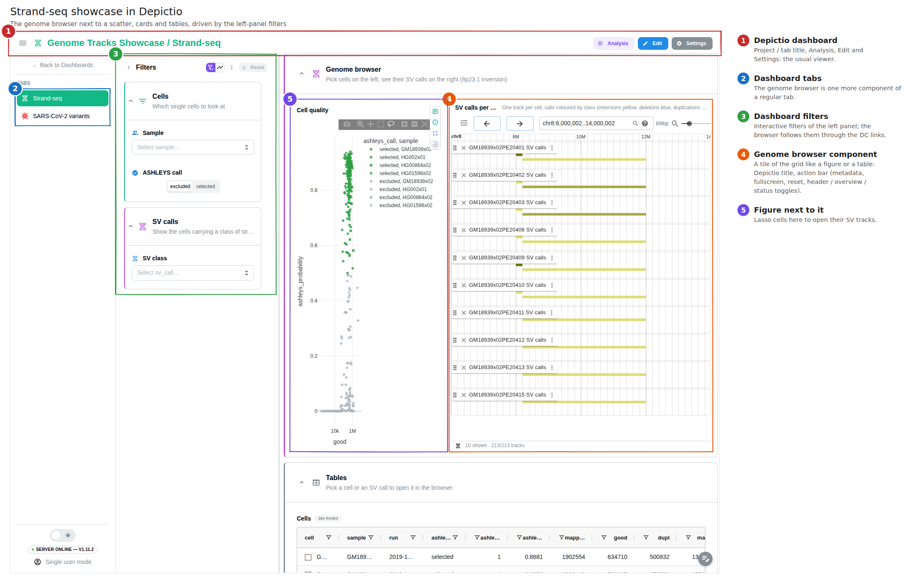

Closer, the same tiles:

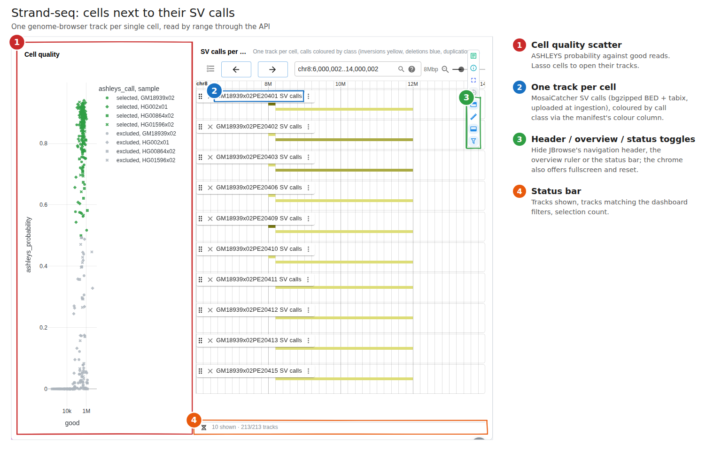

## Architecture

```
 manifest (TSV/CSV/…) ──CLI──► Delta table  ─┐
 track files ──────────CLI──► S3 genomic_tracks/<dc_id>/…   (local files)
 remote s3:// | https:// ──────────────────── (read in place, allow-listed)
                                              │
 viewer ── POST /dashboards/render_jbrowse/{dash}/{component} {filters}
          │   filters extended over DC links → manifest rows → track configs
          │   file locations = signed proxy URLs (HMAC, 6 h)
          ▼
  @jbrowse/react-linear-genome-view2 (lazy chunk, main-thread RPC)
          │  Range GET / HEAD
          ▼
 GET|HEAD /jbrowse/tracks/{dc_id}/{track_key}/{data|index}
 GET|HEAD /jbrowse/assembly/{dc_id}/{role}        custom assembly files
 GET|HEAD /jbrowse/preset/{name}/{role}           built-in assembly files (UCSC)
          │  remote_read: Depictio S3 | allow-listed S3 bucket | allow-listed https host
```

| Piece | Where |
| --- | --- |
| DC model | `depictio/models/models/data_collections_types/genomic_tracks.py` |
| Component model | `JBrowseLiteComponent` in `depictio/models/components/lite.py` |
| Settings | `JBrowseConfig` in `depictio/api/v1/configs/settings_models.py` (`DEPICTIO_JBROWSE_*`) |
| Range reads | `depictio/api/v1/services/remote_read.py` |
| Assemblies, signing, manifest, config builder, render | `depictio/api/v1/services/jbrowse/` |
| Proxy endpoints | `depictio/api/v1/endpoints/jbrowse_endpoints/routes.py` |
| Render endpoint | `render_jbrowse_endpoint` in `dashboards_endpoints/routes.py` |
| CLI upload | `depictio/cli/cli/utils/genomic_tracks_ingest.py` |
| Renderer | `packages/depictio-react-core/src/components/JBrowseRenderer.tsx` (+ `jbrowse/trackSync.ts`) |
| Builder | `depictio/viewer/src/builder/jbrowse/` |

The same code runs in `depictio local up` (no Docker, single origin), Compose
and Kubernetes: there is no extra service, port, volume or CORS origin.

## Genome views and roles

A template can draw genomic coordinates three ways, and they overlap unless each
has one job (RULES.md section 16 states the rules, and
`test_shipped_dashboard_yamls.py` enforces them):

| Role | Tile | Reads | Job |
| --- | --- | --- | --- |
| Summary | Plotly: `manhattan`, `coverage_track`, `cnv_profile`, `sashimi` | a table | the whole genome at a glance |
| Navigator | GenomeSpy `genome_view`, `region_filter_enabled: true` | a table | brush a region; the dashboard follows it |
| Locus detail | `jbrowse` | the run's files | reads, variants and peaks at one locus |

The consequences for a template:

- One `jbrowse` per template, in the tab that works at a locus. The exception is
  a template whose tabs show disjoint track sets (oncoanalyser, variantbenchmarking)
  and the showcase.
- A `genome_view` is a navigator, unless it stacks per-sample lanes. A tile that
  only follows a brush adds nothing a `coverage_track` or the browser does not
  already show.
- The same table is drawn once on a genomic axis per tab, or as a navigator plus
  one detail tile.
- A template with a browser pins the Plotly tiles to their Plotly view, so no
  toggle leads to a second locus view of the same rows.
- A navigator opens in pan mode (a drag moves the axis, the wheel zooms; hover
  and clicks work). `top_stars: N` draws the N best scores as gold, silver and
  bronze six-pointed stars (two overlaid triangles: GenomeSpy has no star
  shape), and `hover_cols` adds columns to the hover tooltip.

### Open in genome browser

The genomic tiles of the other tabs (manhattan, coverage, copy number, sashimi,
and the navigator) carry an "Open in genome browser" action instead of a copy of
the browser. The locus comes from, in this order: the last point clicked
(chromosome and position, padded), the region of the active `genome_selection`
filter, then the visible window when it covers a single chromosome. The action is
disabled when none gives a locus, or when the family has no browser.

Switching tab reloads the page, so the locus travels through `sessionStorage`
(`depictio:pending-locus:<familyId>`: dashboard id, tile index, locus, a 60 s
timestamp), read once by the browser's tile when it builds and deleted. When the
browser is in the same tab, a `depictio:pending-locus` window event does the same
and scrolls the tile into view. A pending locus has priority over every opening
level and is not stored as a reader navigation.

### The browser follows the navigator

A `genome_view` brush publishes a `genome_selection` region filter (chromosome
plus position range). The browser of the same tab reads it and navigates to the
region, resolving contig aliases through the assembly. It does not filter: the
region is removed from the filters sent to the render endpoint, so `locus_from`
is not narrowed by the brush and the manifest keeps every track.

### Floating evaluation

`placement: floating` was tried as the way to reach the browser from every tab.
The panel is too small to read alignments, and enlarged it covers the tiles that
drive it. It stays available as an option (the showcase has one) and no template
uses it; the action above replaces it.

## The `genomic_tracks` data collection

A table of track files: one row per track. It is ingested like a table DC (so
it can be shown in a table, filtered, linked) and the files it names are either
uploaded or read in place.

```yaml
- data_collection_tag: tracks
  config:
    type: genomic_tracks
    metatype: Metadata
    scan: {mode: single, scan_parameters: {filename: tracks.tsv}}
    dc_specific_properties:
      format: TSV
      polars_kwargs: {separator: "\t"}
      uri_column: uri
      track_id_column: track_id
      sample_column: sample
      format_column: format
      name_column: name
      color_column: color
      category_column: category
      order_column: order
      assembly: hg38
      # Read relative rows in place (else: uploaded from the data location)
      remote_base_uri: s3://nf-core-awsmegatests/chipseq/results-…/
      display_defaults:
        bigwig:
          displays: [{type: LinearWiggleDisplay, height: 60}]
      presets:
        tall_signal:
          formats: {bigwig: {displays: [{type: LinearWiggleDisplay, height: 120}]}}
```

| Key | Default | Meaning |
| --- | --- | --- |
| `uri_column` | `uri` | Relative path, `s3://…` or `https://…` |
| `track_id_column` | – | Stable id (else a hash of the uri) |
| `sample_column` | – | Column tracks are filtered and emitted on |
| `format_column` / `default_format` | `format` / – | Track format, else inferred from the extension |
| `index_column` | `index_uri` | Index; `.tbi` / `.csi` / `.bai` / `.crai` / `.fai` / `.gzi` inferred otherwise |
| `name_column`, `color_column`, `category_column` | – | Label, colour, track-selector folder |
| `order_column` | – | Row order the browser opens with (ingestion clusters rows by link columns, so order must be explicit) |
| `assembly` | `hg38` | Preset name/alias or a custom assembly (below) |
| `remote_base_uri` | – | `s3://` or `https://` folder relative rows are read under |
| `direct_access` | `false` | Browser fetches `https://` tracks itself (host must send CORS) |
| `display_defaults` | `{}` | Track config merged into every track of a format |
| `presets` | `{}` | Named fragments a component can pick (`formats`, `view`, `configuration`, `location`) |

**Formats:** `bigwig`, `bedgraph` (tabix), `bed` / `bed.gz`, `bigbed`,
`narrowpeak`, `broadpeak`, `vcf`, `bam`, `cram`, `gff3`, `gtf`, `hic`, `fasta`.
Tabix formats need a `.tbi`/`.csi`; BAM/CRAM need `.bai`/`.crai`; small plain
BED/narrowPeak files are read whole (capped by `max_full_read_mb`).

**Custom assembly:**

```yaml
assembly:
  name: MN908947.3
  display_name: SARS-CoV-2 Wuhan-Hu-1
  aliases: [wuhCor1, NC_045512.2]
  twobit_uri: https://hgdownload.soe.ucsc.edu/goldenPath/wuhCor1/bigZips/wuhCor1.2bit
  # or fasta_uri + fai_uri (+ gzi_uri for bgzipped FASTA)
  chrom_sizes_uri: https://hgdownload.soe.ucsc.edu/goldenPath/wuhCor1/bigZips/wuhCor1.chrom.sizes
  refname_aliases_uri: https://hgdownload.soe.ucsc.edu/goldenPath/wuhCor1/bigZips/wuhCor1.chromAlias.txt
```

**Assembly presets** (UCSC 2bit + chrom.sizes + chromAlias, with a gene track):
`hg38`, `hg19`, `hs1` (T2T-CHM13v2.0), `mm10`, `mm39`, `wuhCor1` (SARS-CoV-2),
`sacCer3`, `dm6`, `ce11`, `danRer11`, `TAIR10` (GenArk). Aliases such as
`GRCh38`, `GRCh37`, `T2T-CHM13v2.0`, `GRCm39` resolve to them.
`GET /depictio/api/v1/jbrowse/assemblies` lists them.

### Ingestion

`depictio run` / `depictio data sync` write the manifest as a Delta table, then:

- relative rows found under the data location are uploaded with their index to
  `s3://<bucket>/genomic_tracks/<dc_id>/…` (removed with the DC / project);
- with `remote_base_uri`, or for rows that are already `s3://` / `https://`,
  nothing is copied: the files are read in place.

Recipes get a second `context` argument (`RecipeContext`: `data_dir`,
`properties`, `reads_in_place`, `exists()`, `glob()`), which lets a template
recipe spell out every expected track when the files are read in place and keep
only the present ones when they are uploaded.

## The `jbrowse` component

```yaml
- component_type: jbrowse
  workflow_tag: rnaseq
  data_collection_tag: tracks
  title: Genome browser
  location: chr11:5,240,000-5,300,000   # optional; else the first call, else the data
  track_mode: filtered        # or `all`: every track, filters ignored
  max_tracks: 16              # cap on tracks shown under a filter
  initial_tracks: 6           # tracks shown when nothing is filtered
  initial_categories: []      # or: open on these track categories (of the first one's sample) instead
  default_tracks: []          # track ids always shown
  show_annotation: true       # the preset's gene track
  ucsc_tracks: [clinvarMain]  # UCSC tracks opened by default (see below)
  force_load: false           # start with force load on
  fetch_size_limit_mb: 5      # per-track download limit before "Force load"
  selection_enabled: true     # emit a filter back to the dashboard
  selection_column: sample    # default: the DC's sample_column
  selection_mode: feature_click   # or visible_tracks
  show_header: true           # JBrowse navigation header
  show_overview: true         # overview / ruler bar
  track_labels: offset        # offset | overlapping | hidden
  locus_from:                 # navigate to the filtered rows of another DC
    data_collection_tag: variants
    chrom_column: CHROM
    start_column: POS
    end_column: END
    padding: 150
    max_rows: 3
    sort_by: AF               # order of the calls: first call, picker
    descending: true
    label_column: mutation_label   # name of a region in the picker
    mate: {chrom_column: CHROM_B, start_column: POS_B}   # second side of a call
    # locus_from may also be a list of such sources (see "Navigating regions"); each
    # accepts name, color, workflow_tag, sample_column, run_column, columns, search_columns
  show_density: true          # genome-wide density of the regions under the header
  show_junctions: false       # sashimi arcs on RNA alignments
  read_pairs_display: pileup  # DNA alignments open as pileup | arcs | cloud
  display: {scale: log}       # default display settings, see "Display settings"
  call_stepper: true          # next / previous region and the region picker
  follow_window: true         # follow the region of the other genome tiles
  auto_height: true           # the tile is as tall as its open tracks (3 to 16 grid rows)
  views: [breakpoint, circular]   # extra views; breakpoint needs locus_from.mate
  circular_categories: [sv]   # track categories the circular view draws
  color_by: condition         # manifest column that colours and groups tracks
  placement: grid             # or floating (a panel kept across the tabs)
  floating_initial_state: compact   # compact | expanded | docked | hidden
  preset: signal              # built-in (sv-calls, signal, compact, peaks) or the DC's own
  config_overrides:           # raw JBrowse config, merged last
    formats: {bam: {displays: [{type: LinearAlignmentsDisplay, height: 80}]}}
    tracks: {<trackId>: {name: …}}
    extra_tracks: [{type: FeatureTrack, trackId: …, adapter: …}]
    assembly: {…}
    view: {…}
    configuration: {…}
```

**Merge order** for a track: format base config → preset `formats` → DC
`display_defaults` → component `config_overrides.formats` → `config_overrides.tracks[trackId]`.
Display lists are merged by display `type`, so an override can change a height
without restating the display.

**Cross-filtering** works like the image gallery:

- *dashboard → browser*: the render endpoint extends the filters over DC links
  (`_resolve_link_filters_cached`, same path as `render_image_paths`) and
  applies them to the manifest. Only changed tracks are shown/hidden
  (`showTrack` / `hideTrack`), the view is never rebuilt, so the locus is kept.
- *browser → dashboard*: a feature click (or the open-track set in
  `visible_tracks` mode) emits a `jbrowse_selection` filter on
  `selection_column` with `metadata.dc_id` = the tracks DC. Links from the
  tracks DC propagate it. The component drops its own filter before fetching,
  so selecting does not hide the other tracks.
- `locus_from` frames the filtered rows of another DC (e.g. a picked variant,
  or every mutation of a gene) when between 1 and `max_rows` remain: from the
  smallest start to the largest end among the rows on the most frequent
  chromosome (ties: the one seen first), `padding` bases on both sides, start
  clamped at 1. Above `max_rows` the view does not move; what it shows then is
  the opening locus below. With `span_top: N` the first call of the opening
  locus becomes the first N calls (in `sort_by` order), framed together when
  they lie on one chromosome within `max_span` bases (default 1 Mb), else the
  first call alone: the best few variants of one locus show in one window.
  The window is centred on the first call. Rows without coordinates are
  placed by a gene search on `locate_column` (a transcript id), else
  `label_column`.
- The rows the view points at (the filtered rows, else the best three of the
  calls the opening frames) come back as `picked`: one unpadded locus per row, the names a feature carries
  (the `locate_column` value, else the label) and per row the key columns
  (chromosome, start, locate column). The viewer rewrites each track's
  renderer colours (`color1`, `color3`, `outline`, `labels.nameColor`) as a
  jexl test in front of the track's own colour: a variant (or a call of the
  rank track) is picked by position, an annotation feature by name, version
  suffix ignored, an exon through its transcript, or by its gene symbol
  (`geneName` of UCSC's knownGene, `name2` of ncbiRefSeq; knownGene's `name2`
  is a UCSC id and `geneName2` a UniProt one). Picked features take the
  theme's primary colour, an outline and a star in front of their name; the
  others keep theirs. At the opening (`picked.medals`) the best three calls
  keep their own colour and wear a gold, silver and bronze star and name
  instead. With a `locate_column`, `picked.genes` names the gene a picked
  transcript sits under (an Ensembl id resolved to its symbol through the
  UCSC search): that gene is starred, not coloured. The gene annotation
  groups transcripts under their symbol (`aggregateField: geneName` for
  knownGene, `name2` for ncbiRefSeq; JBrowse's default is the UniProt id).
  The canvas renderer sends the client its layout and labels, not the
  features, so a starred label is how the viewer finds the pick: the track
  grows to show it (up to 320 px) and scrolls to it once. A double click on
  the bottom edge of a track (its last pixels, the handle, or the gap to the
  next track, found by geometry) fits it to its content (up to 1200 px). A
  navigation asked before the view knows its assembly waits for it. A table row
  carrying every key column with the same values (any collection, matched by
  column name like a filter) wears the same colour as a left bar, and so does
  a row selected in a table.
- `rank_track: N` adds a feature track of the first N calls (`sort_by` order,
  under the dashboard filters but not the `*_selection` ones, so a call keeps
  its rank once clicked), each named `#rank label` (a star in front of the
  first three), under the gene annotation. `rank_color_by: <column>` fills
  each call with that column's dashboard category colour, as a genome_view
  coloured by it does. A picked row below the top is drawn too, by its label,
  and an open view takes the new features into the existing track config.
  Its features live in the config (`FromConfigAdapter`); a reader whose track
  set was saved before the track existed sees it open once.
- A table driving the browser can set `row_selection_mode: single`: a click
  replaces the picked row instead of adding to it, so the browser frames one
  feature.
- A click on a feature opens depictio's panel instead of JBrowse's widget:
  the panel reads the JSON JBrowse hands its widget (nothing is refetched).
  A gene model shows its symbol as the title, then the transcript, gene,
  UniProt and UCSC ids, biotype, class and tags; the rest stays under
  "All fields".

**Chrome:** the tile's settings action (the same icon and *Controls* popover
as every other tile's viz settings) holds one switch per display option,
grouped as *View* (JBrowse header, overview ruler, status bar), *Loading*
(force load) and *Interaction* (click-to-filter). Defaults come from the YAML
and each viewer's choices are remembered, next to reset, metadata and
fullscreen. JBrowse menus and dialogs portal into the fullscreen element, so
they keep working there.

**Versions:** a version preview (`?version=`) or a dataset pin reads the
manifest at its stamped Delta commit (the `genomic_tracks` manifest is stamped
like a table; the track files it names are not versioned, reported as
`track_files_not_versioned`), and so is the `locus_from` collection. The signed
track URLs name that commit (`v=`, part of the signature), so the proxy serves
the files of the same manifest. Under a version the browser opens on that
version's tracks and locus and never writes the viewer's remembered ones.

**Loading tracks:**

- *One by one.* The **Tracks** menu of the tile's action bar lists every track
  the view carries (search, one checkbox per track, grouped by the manifest's
  `category_column`, then UCSC and reference tracks), with *Show all* (capped),
  *Hide all* and *Back to filters*. The view carries every track matching the
  filters, up to 500 (the whole manifest with `track_mode: all`); only
  `max_tracks` of them open. Manual choices hold until the filters change.
  JBrowse's own track selector (list icon of the navigation header) shows the
  same tracks.
- *Force load.* JBrowse stops at a per-track download limit (1 MB by default,
  `fetchSizeLimit`) and shows a *Force load* button in the track.
  `fetch_size_limit_mb` sets that limit on every display (the pileup and
  SNP-coverage sub-displays of alignments included). The **Force load** toggle
  of the action bar lifts it for every open track, and for tracks opened or
  zoomed out later, which is what JBrowse's per-track button does. `force_load:
  true` makes it the default; each viewer's choice is remembered.
- *UCSC tracks.* `ucsc_tracks` names UCSC Genome Browser tracks (`clinvarMain`,
  `encodeCcreCombined`, `artic`, ...) opened next to the collection's tracks.
  Names are resolved through the UCSC REST API (`/list/tracks`) for the
  assembly's UCSC genome: the preset's database, the GenArk accession of TAIR10,
  or a custom assembly's alias (`MN908947.3` -> `wuhCor1`). Tracks backed by a
  bigWig, bigBed-family or tabix VCF file are supported; database-backed tracks
  (e.g. hg38 `cpgIslandExt`) have no file and are reported in `ucsc_missing`.
  Files are read from `hgdownload.soe.ucsc.edu` (or an allow-listed host)
  through `/jbrowse/ucsc/{genome}/{track}/{data|index}`, a public proxy that only
  reads files of UCSC's own catalogue; `DEPICTIO_JBROWSE_PRESET_ACCESS=direct`
  lets the browser read UCSC itself. The catalogue is cached per genome
  (`DEPICTIO_JBROWSE_UCSC_CATALOG_TTL_S`); the builder searches it through
  `GET /jbrowse/ucsc/{assembly}/tracks?q=`.

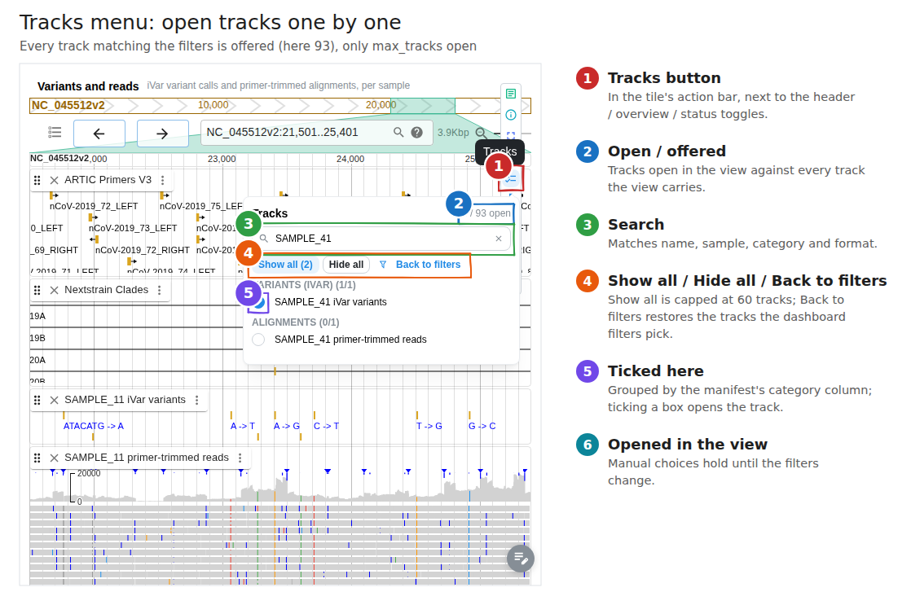
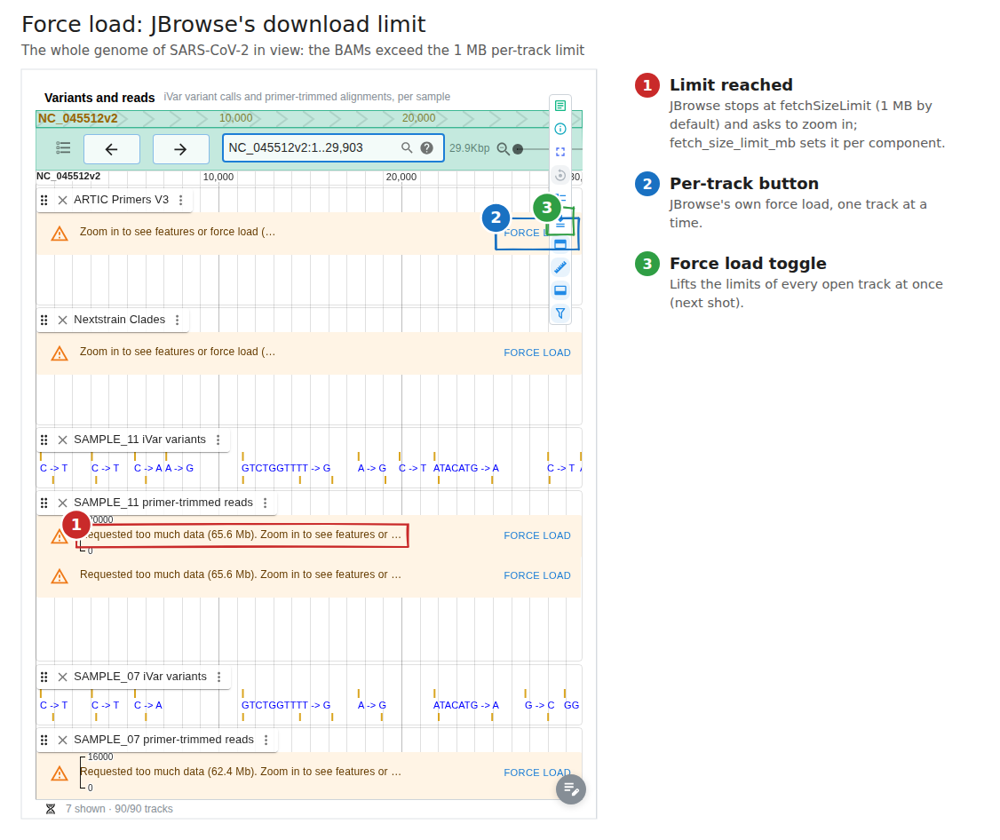
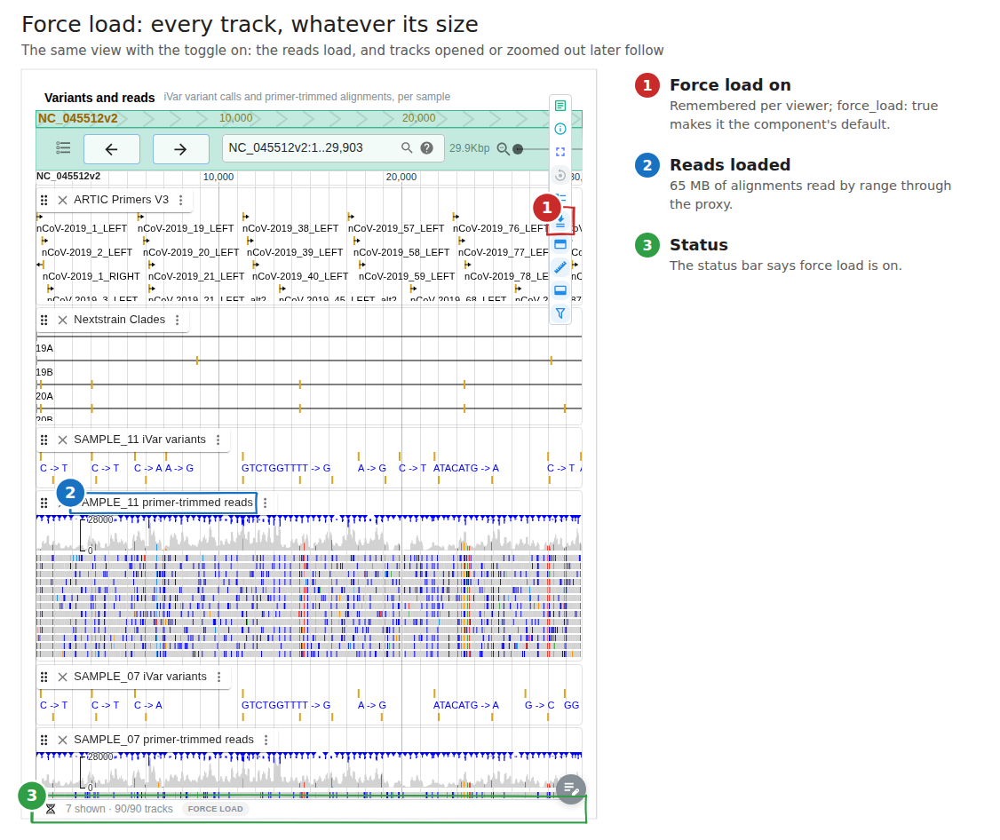
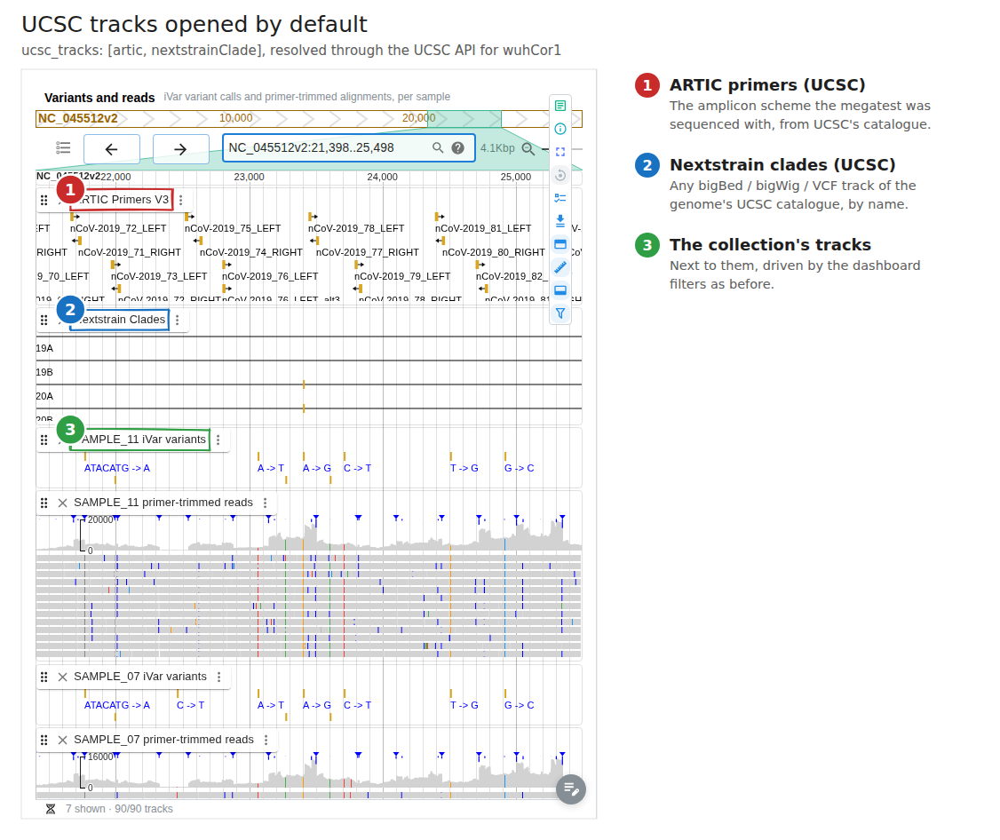

**Builder:** the component builder has a *Genome browser* type with the
assembly, locus, tracks, display toggles, cross-filtering, "follow filtered
rows", preset and a JSON override editor, plus a live summary of the tracks the
current filters would show.

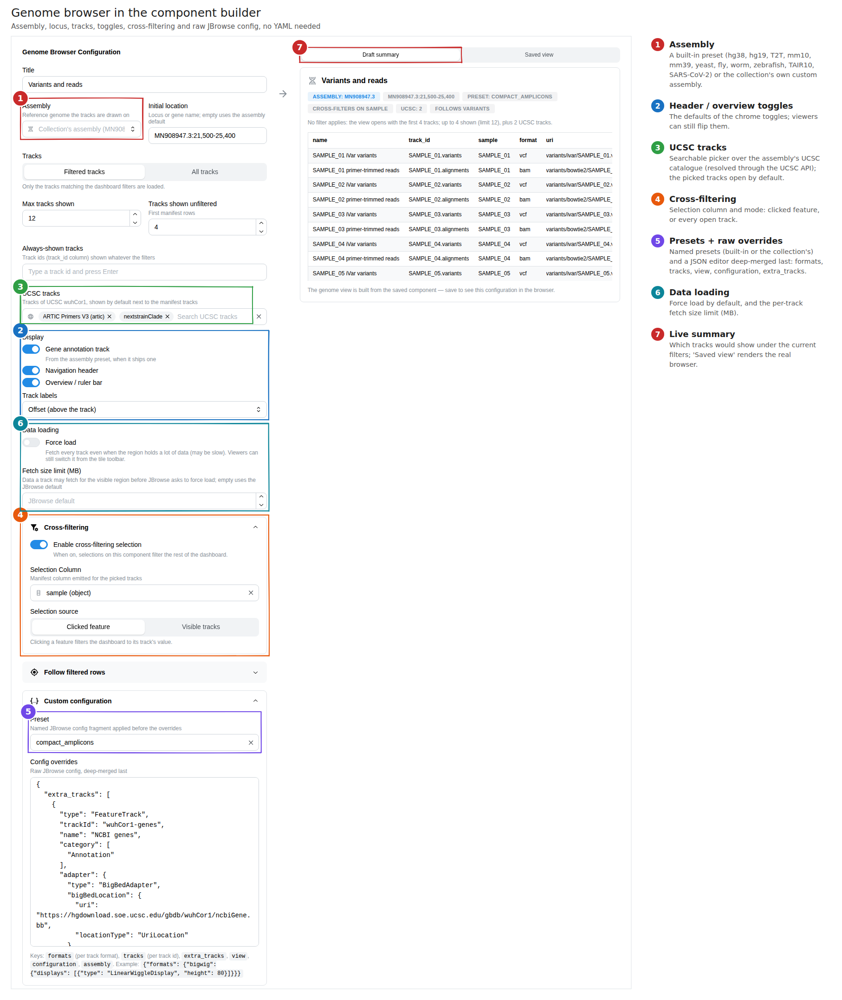

### Opening locus

The browser opens where the data is, not on the assembly's default view. The
render payload carries `location` and `opening`, the level that produced it; the
first level that gives a locus wins:

1. `filter`: a dashboard filter narrowed the `locus_from` collection to at most
   `max_rows` rows (a picked table row, a volcano point, a gene). With
   `frame_gene: true` the frame also holds the whole gene the row names in
   `label_column` (the UCSC gene search), so a picked ORF or transcript opens
   inside its gene, in the row's own chromosome naming;
2. `yaml`: the tile's `location`;
3. `first_call`: the first row of `locus_from` (of the filtered rows, when there
   are some), ordered by `sort_by`, `descending` by default; without `sort_by`,
   the collection's own order;
4. `data`: the first region holding data in the first tracks shown, read from
   their index (BAI, tabix, bigWig); any failure falls through;
5. `preset`: the assembly preset's default view.

A template declares a `sort_by` on its `locus_from` (RULES.md section 16) so
level 3 gives the call worth looking at first: the most supported fusion, the
highest-quality variant, the most significant peak. A template with no
`locus_from` opens on level 4. Only `filter` and `yaml` move a view that is
already open; the other levels are defaults for a view that has just been
created, so a refetch never pulls the reader away.

The viewer remembers the locus a reader left the view at (per tile, in
`localStorage`, key `.loc.v2`) and writes it only after a navigation by the
reader, never for the opening view. A locus saved by an older build is ignored.

### Navigating regions

When the tile has a `locus_from`, its regions (the rows of the collection, under
the current filters) can be walked, picked and surveyed. Nothing here writes a
filter: moving the view is not a selection. `call_stepper: false` hides the
next / previous buttons and the picker; `show_density: false` hides the strip.

- **Next / previous region.** The buttons step by position, like IGV's Ctrl+F /
  Ctrl+B: the next region is the first whose start is past the current position
  (the previous: the one whose end is before it), and past the last region of a
  chromosome the first one of the next chromosome of the assembly. They run over
  the merged regions (below), so six samples that all have a peak at the same
  place are one stop. There is no wrap-around at the ends.
- **Region picker.** A grid (AG Grid) listing the regions, sortable by any column
  (`sort_by`, `label_column`, `sample_column`, `run_column`, the `columns` of the
  source, plus chromosome, start, end), with a search box matching
  `label_column` and `search_columns` (case-insensitive substring), paged on the
  server. Picking a row moves the view to it (padded by `padding`; with a `mate`,
  the view shows both sides).
- **Density heatmap.** A strip under the header: one row per source (or per
  sample or run), one cell per genome bin, coloured by how many regions start in
  it. Clicking a cell moves the view there. It answers "where are the regions"
  for 200 000 peaks, which no stepper can.

All three read the same data and the same filters as the render: the regions of
the collections, filters extended over DC links, at their pinned commit.

#### Merged regions

With `merge`, regions of one source that overlap, across samples and runs, are
joined into one. Sources are never merged together: a copy-number segment spans
megabases and would swallow every variant under it, so each omics layer keeps
its own stops (a peak and the consensus interval on it are two stops). They are ordered by chromosome and start; a region starts a new
group when its start is past the largest end seen so far on its chromosome. A
merged row spans the union and reports `n_rows`, `n_samples` (distinct values of
`sample_column`), `samples` (at most 10 names) and `sources`. Its `score`, label
and `source` are those of the best row: the largest `sort_by` value when
`descending`, else the smallest.

#### Several sources

`locus_from` is one source or a list. List the sources rather than adding tiles
when the regions belong together (ATAC peaks, the differentially expressed genes
and the variants of one question):

```yaml
locus_from:
  - name: Peaks
    data_collection_tag: consensus_peaks
    workflow_tag: atacseq        # only when several workflows have the tag
    chrom_column: chr
    start_column: start
    end_column: end
    sort_by: score
    sample_column: library
    columns: [fold, gene]
    search_columns: [gene]
    color: teal
  - name: DE genes
    data_collection_tag: de_genes
    workflow_tag: rnaseq
    chrom_column: chromosome
    start_column: pos
    label_column: symbol
    color: orange
```

The first source is the primary one. It alone frames the view when the filters
narrow it (the opening locus above), carries the `mate`, and is what "Use this
region" filters on (`locus_source`). Calls, merging and density use every source;
the viewer lets a reader switch sources off. A source is named by `name`, else by
its collection tag; names are unique in a tile. `workflow_tag` picks the
collection of that workflow when several workflows share the collection tag.
Filters reach each source through its own DC links, so a source whose collection
no link reaches ignores the filters on others.

`sample_column` and `run_column` name the library and the run a region belongs
to, on a collection that holds the regions of several. They feed `n_samples`, the
sample and run columns of the picker, and the density grouped by sample or run
(a source without the column stays one row). Up to 64 rows are drawn, the
busiest kept.

#### Endpoints

`POST /dashboards/jbrowse_calls/{dashboard_id}/{component_index}` (same filters,
link resolution, version pins and permission check as the render) takes
`{filters, start, limit (at most 200), sources, sort: {column, descending},
search, near: {chrom, pos, direction, chrom_order}, merge}`, all but the filters
optional. `sort.column` is a common-shape name (`chrom`, `start`, `end`, `score`,
`label`, `sample`, `run`, `source`; merged: `n_rows`, `n_samples`) or a raw
column of a source; anything else is a 400. `near` returns at most one row while
`total` stays the full count. It answers `{total, rows}`; a row has `locus`,
`mate_locus` (primary source only), `label`, `chrom`, `start`, `end`, `score`,
`extra` (the `columns` cells), `source`, `sample`, `run` and, merged, the counts
above. Without the optional keys and with one source, a request is read as a
Delta page as before; the other modes read the filtered regions into memory and
keep them in a small cache keyed by the filters, the pinned commit and the
collection's aggregation version, so paging and searching do not read Delta again.

`POST /dashboards/jbrowse_call_density/{dashboard_id}/{component_index}` takes
`{filters, regions: [{refName, length}], bins (1 to 2000), sources, group:
source | sample | run}` and answers `{bin_size, max, tracks, truncated}`: one bin
size (bp) for the whole genome, and per track the counts of each region.

Chromosome names are compared without the `chr` prefix everywhere (`chr1` is
`1`, `M` is `MT`), including in the `genome_selection` filter the region picker
and "Use this region" publish, since a collection and the assembly rarely agree.

### Gene search

Typing a gene name in the locus box searches it. For a preset assembly the
browser asks `GET /jbrowse/preset/{name}/search?q=&limit=10`, which proxies the
UCSC search API for that genome (HGNC and MANE entries first, deduplicated,
cached in the API process). A custom assembly has no search: type a locus, or
use `location`.

### Extra views (breakpoint, circular)

`views` adds buttons to the tile's toolbar; each opens its view in a large
dialog, loaded on demand as its own chunk.

- **Breakpoint view** (`breakpoint`, needs `locus_from.mate`): JBrowse's breakpoint
  split view, two stacked panes on the two sides of the current call, joined by
  the split reads and discordant pairs of the open alignment tracks. The mate
  columns come from the same row as the primary locus: `mate: {chrom_column,
  start_column, end_column}` (the end defaults to the start). The call is the one
  the view stands on, else the one the view opened on.
- **Circular view** (`circular`): the structural variants of the tracks as chords.
  It draws the tracks whose manifest `category` is in `circular_categories`
  (default `["sv"]`; the payload lists them as `sv_track_ids`), and is hidden when
  there are none. A recipe that names its SV folder otherwise ("Structural
  variants") sets `circular_categories` to that name.

With a mate, the toolbar menu also has **Both sides**, on by default: one view
with two regions, the call and its mate, side by side.

### Read pairs and junctions

- `show_junctions: true` draws the splice junctions as arcs (sashimi) over the
  coverage of the RNA alignment tracks.
- `read_pairs_display` sets how DNA alignment tracks open: `pileup` (default),
  `arcs` (read arcs, a discordant pair is an arc between its mates) or `cloud`
  (read cloud, pairs by insert size). The other displays stay in each track's
  menu. Use `arcs` on a structural-variant tab.
- `color_by: <manifest column>` colours the signal and coverage tracks by that
  column, from the dashboard's `category_colors`, and groups the Tracks menu by
  it (a track whose manifest row already carries a `color` keeps it).

### Display settings

The toolbar menu groups the display settings by kind of track: View,
Alignments, Coverage, Features and Variants. A group only appears while a track
of that kind is open. `display:` gives the dashboard's defaults, every key
optional:

```yaml
display:
  # view
  center_line: false
  gridlines: false
  cytobands: true
  track_outlines: false
  color_by_cds: false
  track_labels: offset          # offset | overlapping | hidden
  # alignments
  color_scheme: strand          # normal | mappingQuality | strand | perBaseQuality |
                                # stranded | pairOrientation | insertSize | tag |
                                # modifications | methylation
  color_tag: HP                 # only with color_scheme: tag, and required then
  soft_clipping: false
  mismatch_alpha: false
  read_height: compact          # normal | compact | super_compact
  hide_small_indels: false
  hide_mismatches: false
  lower_panel: pileup           # pileup | arcs | cloud
  coverage_height: 80           # 20 to 2000
  sashimi_arcs: false
  min_arc_score: 2
  # quantitative tracks
  scale: log                    # linear | log
  autoscale: local              # local | global | globalsd | localsd
  renderer: xyplot              # xyplot | density | line
  fill: filled                  # filled | line | emphasis
  summary: avg                  # min | max | avg | whiskers
  # feature tracks
  feature_mode: compact         # normal | compact | reducedRepresentation | collapse
  feature_labels: true
  feature_descriptions: false
  gene_glyph: longestCoding     # all | longest | longestCoding
  # variant tracks
  variant_row_height: 10        # 1 to 50
  phased: false
```

**Precedence**, highest first: the viewer's own choice in the menu (kept in the
browser, per tile), then `display:`, then JBrowse's default. "Reset to dashboard
defaults" in the menu drops the local choices. `track_labels`, `sashimi_arcs`
and `lower_panel` overlap the top-level `track_labels`, `show_junctions` and
`read_pairs_display`: the top-level fields keep working, and setting both to
different values is a validation error. The same value on both is accepted.
`color_by` colours tracks by a manifest column and is not a `color_scheme`.

### Selecting a region and hover links

With `locus_from`, the tile can drive the dashboard as well as follow it:

- the header's "Use this region" button, and the "Use this region" entry of the
  menu that opens after dragging across the ruler (rubberband), emit a
  `genome_selection` filter on the `locus_from` chromosome and start columns.
  Everything that follows a region (Manhattan, tables, GenomeSpy) narrows to it.
  The region stays drawn as a band in the browser;
- a second click on the button, or the tile's Reset, clears the filter;
- the button needs `locus_from`: the render payload carries `locus_source`
  (`{dc_id, chrom_column, start_column, end_column}`, null without
  `locus_from`), and the tile has no button when it is null.

Hover works in both directions, on the shared highlight bus: hovering a feature
in the browser (a variant, a peak, a read, a coverage bin) highlights the
matching points of the Manhattan and the matching rows of the tables, and
draws a line on the coverage and GenomeSpy tracks. Hovering a point or a table
row bands its region in the browser. A table row matches by the coordinate
columns it shares with `locus_from`; a table without them ignores the event.
The view never navigates on hover.

### Linked view and floating

The browser takes part in the dashboard's linked views:

- a click on a feature emits `jbrowse_selection` (`selection_enabled`), which a
  record card can follow through `selection_source`; the card names its
  `selection_column` explicitly;
- `follow_window` (default on) makes it follow the genomic window another genome
  tile publishes (a coverage track, another browser), and publish its own; the
  toolbar switch "Follow other genome tiles" turns it off per viewer. It is
  ignored while Both sides holds two regions. A `genome_view` publishes its
  window only when it opts in (`publish_view_window`); by default only a region
  selected there (the Select mode of its header) moves the browser;
- `auto_height` (default off) sizes the tile to the tracks it has open, between
  3 and 16 grid rows, instead of the stored height; "Fit tracks to the tile" is
  not offered then, since the tracks and the tile would chase each other;
- in a compact density the header is one line, with a "Genome" tag, and the
  table of the shown tracks opens from the toolbar.

`placement: floating` lifts the browser out of the grid into the floating panel,
which stays on screen from tab to tab, like a 3D structure or a map. A floating
tile declares no `section` and no `layout`; `floating_initial_state` is
`compact`, `expanded`, `docked` or `hidden`. The Genome Tracks Showcase has one.

### Metadata panel

The tile's metadata panel (the info icon, and the inspector's Info tab) has a
*Genome tracks* section: assembly (name, aliases, preset or custom), location
(current locus, the `locus_from` collection and columns), the shown tracks by
category (format, sample, file, index, storage), the UCSC tracks, and the data
(live or pinned version, shown out of total, truncation, remote folder). The
tile hands its last render payload and visible locus to a small module store
(`components/jbrowse/genomeTracksStore.ts`), so the panel needs no wiring to
the tile; a tile that has not mounted yet (`LazyMount`) shows its static config
and "Scroll the browser into view to load its tracks.". Read-only: no track
toggles.

The payload carries three fields for it: `storage` per manifest track
(`remote` read in place, `direct` for `direct_access`, `depictio` ingested),
`index_uri` per track, and `data_version` (the pinned manifest commit, or null).
Every URI shown goes through one sanitizer, `display_uri`
(`services/jbrowse/tracks.py`): no userinfo, query or fragment (a presigned
signature never leaves the API), a file name only for an ingested file or an
absolute local path, never a bucket key. `remote_base_uri` is shown as host and
prefix only, and not at all to an anonymous viewer, who sees file names. The
same sanitizer covers the URI cells of `tracks[].metadata`. Only display fields
change: the adapter locations JBrowse fetches (signed proxy URLs, or the https
URL of a `direct_access` collection) are built apart and are untouched.

## Security model

- The browser never receives a storage URL or credentials. Render returns
  **signed proxy URLs**: HMAC over `scope/dc_id/item/role/user/exp`, keyed from
  the internal API key, valid `url_ttl_s` (6 h). The proxy also accepts a bearer
  token, and always re-checks read access on the DC's project.
- Clients send **ids, never URLs**: the proxy looks the file up in the DC's
  manifest (`track_key` = sha1 of the row), so there is no client-driven SSRF.
- Remote reads go only to **allow-listed** https hosts and s3 buckets
  (`DEPICTIO_JBROWSE_REMOTE_HTTPS_HOSTS` / `_S3_BUCKETS`); `http://` is refused;
  redirects are not followed; one Range is served per request (206, end
  clamped; several ranges or a start past the end → 416); ranges are capped at
  `max_range_mb`, full reads at `max_full_read_mb`.
- Depictio's own bucket is only readable inside the DC's
  `genomic_tracks/<dc_id>/` prefix: a `remote_base_uri` or `s3_base_folder`
  pointing elsewhere in it is refused (403).
- Remote S3 is read anonymously unless `DEPICTIO_JBROWSE_REMOTE_S3_ACCESS_KEY` /
  `_SECRET_KEY` are set (Helm: `secrets.jbrowseRemoteS3SecretKey`).
- The built-in assemblies' UCSC files go through `/jbrowse/preset/…`, which
  only fetches the hardcoded preset URLs (public, cached when ≤ 2 MB).
  `DEPICTIO_JBROWSE_PRESET_ACCESS=direct` lets the browser fetch UCSC itself.
- CSP (API and nginx agree): `connect-src` adds `data:` and
  `https://hgdownload.soe.ucsc.edu`; `worker-src 'self' blob:`.

### Settings

| Variable | Default |
| --- | --- |
| `DEPICTIO_JBROWSE_ENABLED` | `true` |
| `DEPICTIO_JBROWSE_REMOTE_HTTPS_HOSTS` | `nf-core-awsmegatests.s3-eu-west-1.amazonaws.com` |
| `DEPICTIO_JBROWSE_REMOTE_S3_BUCKETS` | `nf-core-awsmegatests` |
| `DEPICTIO_JBROWSE_REMOTE_S3_ENDPOINT_URL` / `_REGION` | AWS / `eu-west-1` |
| `DEPICTIO_JBROWSE_REMOTE_S3_ACCESS_KEY` / `_SECRET_KEY` | unset (anonymous) |
| `DEPICTIO_JBROWSE_PRESET_ACCESS` | `proxy` |
| `DEPICTIO_JBROWSE_REMOTE_TIMEOUT_S` | `30` |
| `DEPICTIO_JBROWSE_MAX_RANGE_MB` / `_MAX_FULL_READ_MB` | `64` / `256` |
| `DEPICTIO_JBROWSE_URL_TTL_S` | `21600` |
| `DEPICTIO_JBROWSE_UCSC_TRACKS_ENABLED` / `_UCSC_API_URL` / `_UCSC_CATALOG_TTL_S` | `true` / `https://api.genome.ucsc.edu` / `86400` |

Wired in `docker-compose*.yaml`, the Helm configmap (any `DEPICTIO_JBROWSE_*`
key of `backend.env`), `.env.example` and `depictio local up`.

## Examples

1. **Strand-seq single-cell SVs** (`Genome Tracks Showcase` project, hg38,
   files uploaded). 4 HGSVC samples and 384 cells with their ASHLEYS call;
   213 MosaiCatcher SV BEDs coloured by call class. Lasso cells in the scatter →
   their SV tracks; click an SV → the cell is picked everywhere.
   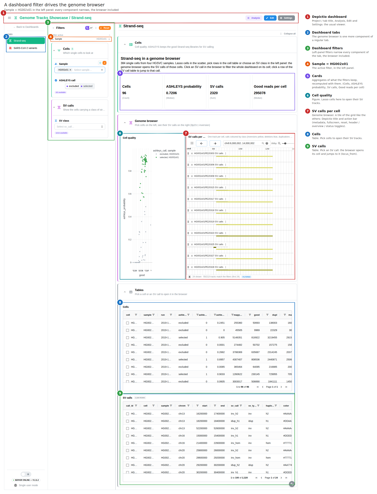
   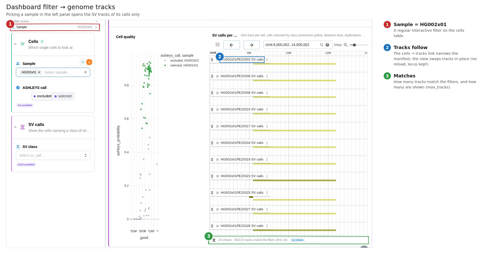
   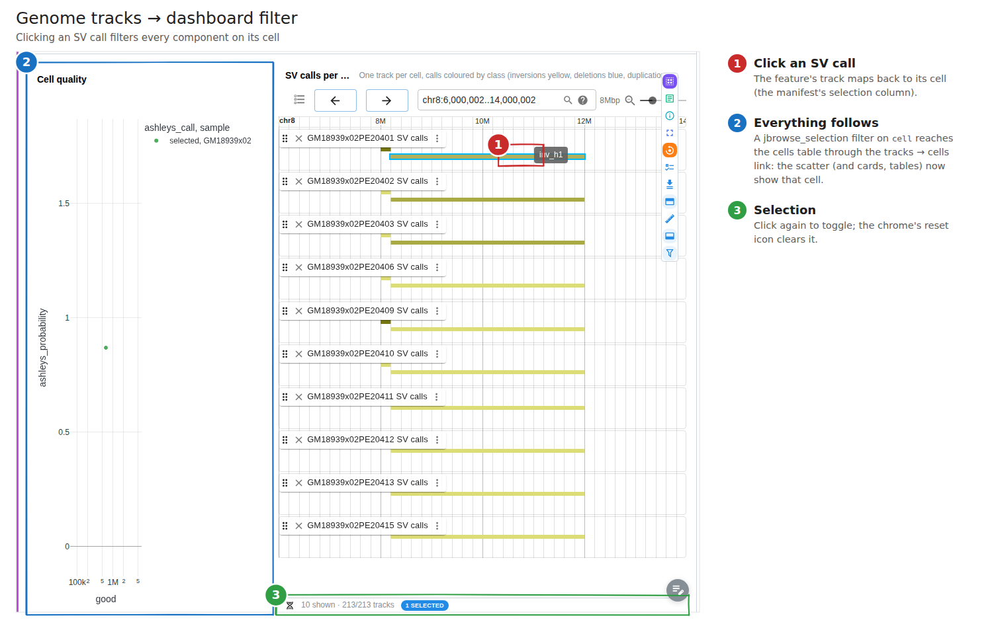
   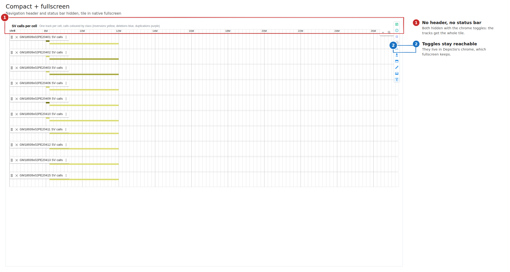
2. **SARS-CoV-2 amplicons** (same project, custom `MN908947.3` assembly, read
   in place from the viralrecon megatest). iVar VCFs + primer-trimmed BAMs,
   `locus_from` jumps to the picked variant, a custom `compact_amplicons`
   preset and an extra UCSC gene track from `config_overrides`.
   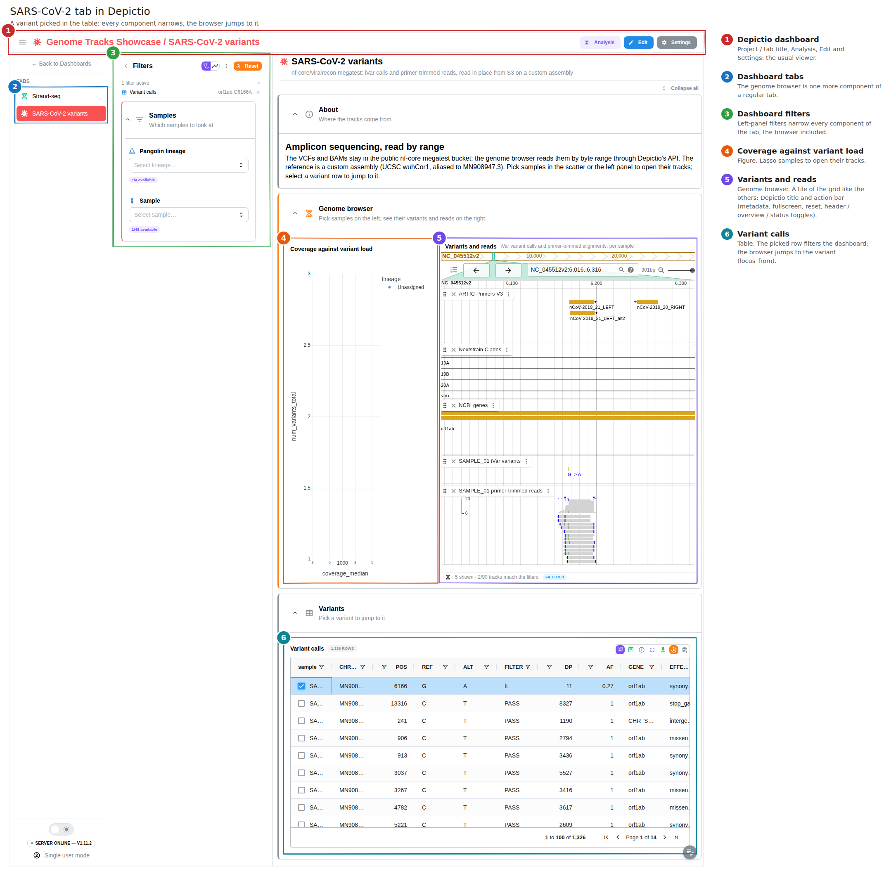
   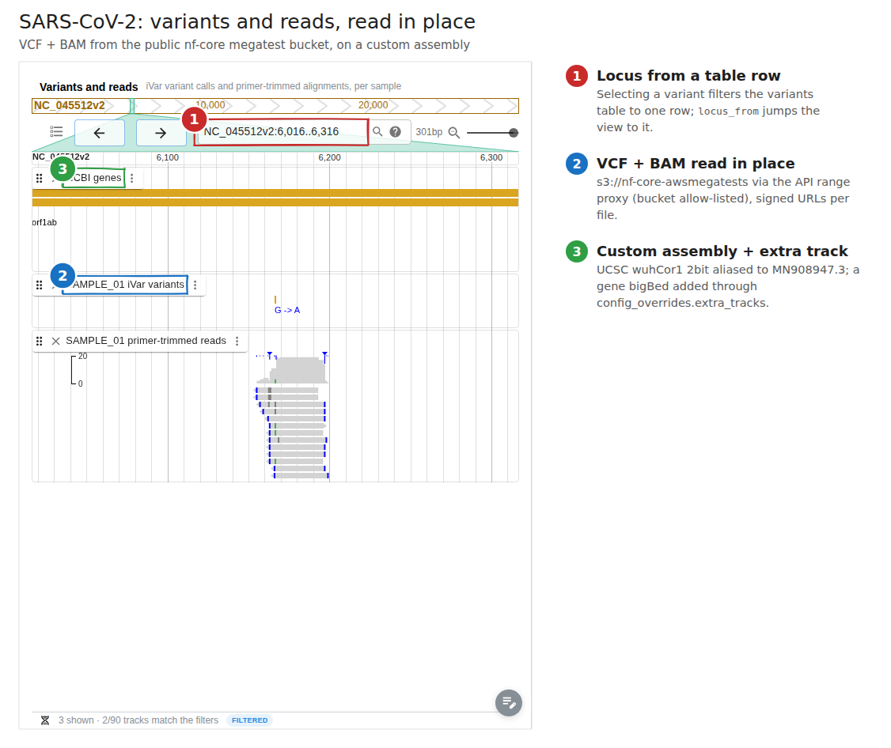
3. **nf-core/cutandrun 3.1**: *Genome tracks* tab: bigWig per sample coloured
   per target, SEACR and MACS2 peaks, deduplicated BAM, driven by the target
   filter; cards, a SEACR Manhattan and a region table on the same tab.
   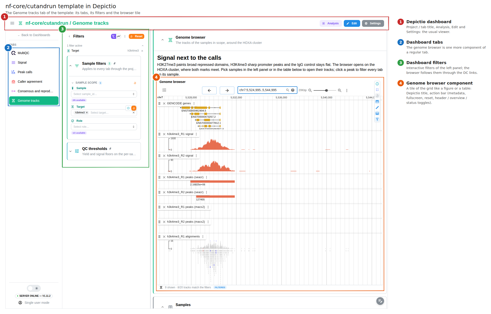
   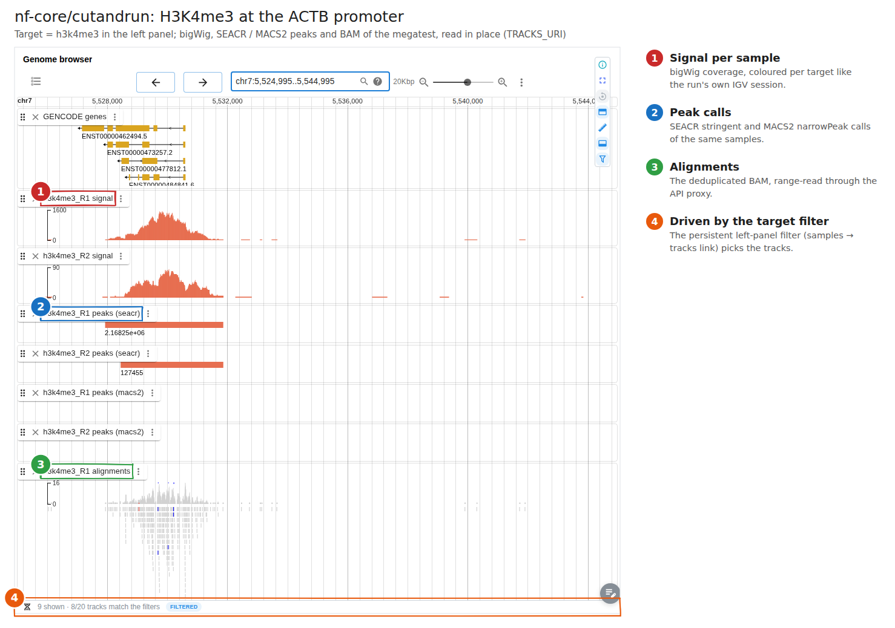
   A region picked in the table (or on the Manhattan) opens its sample's
   tracks on it (`seacr_peaks -> tracks` link + `locus_from`), and every other
   component of the tab narrows with it:
   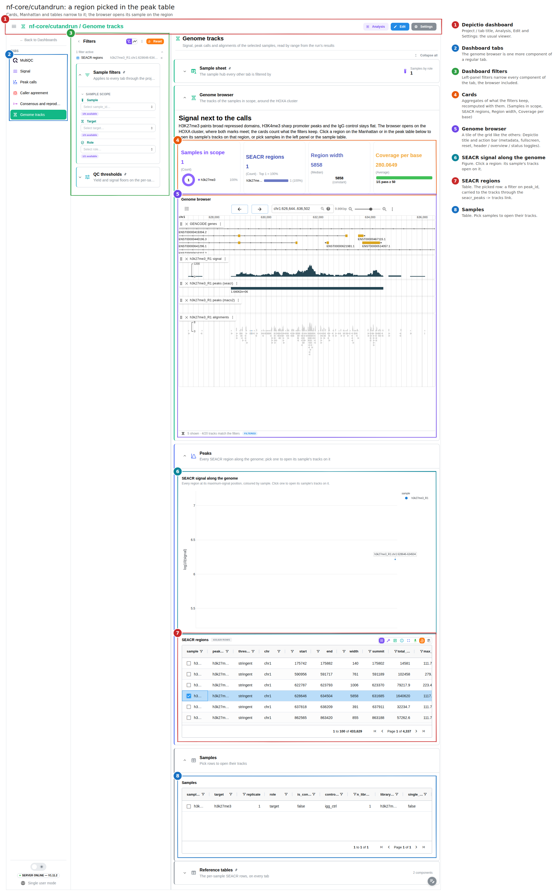
   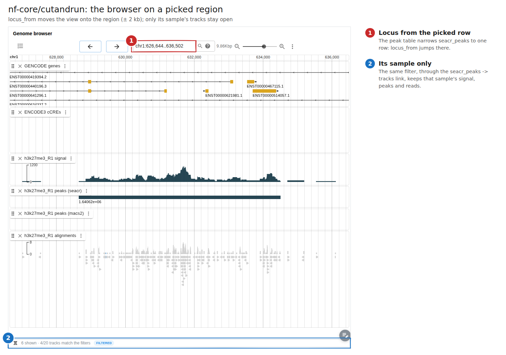
4. **nf-core/chipseq 1.2.0**: ChIP and input bigWigs, MACS2 narrowPeak calls
   and BAM per antibody (hg19 megatest), with cards, a MACS2 Manhattan and a
   peak table that drive it the same way. 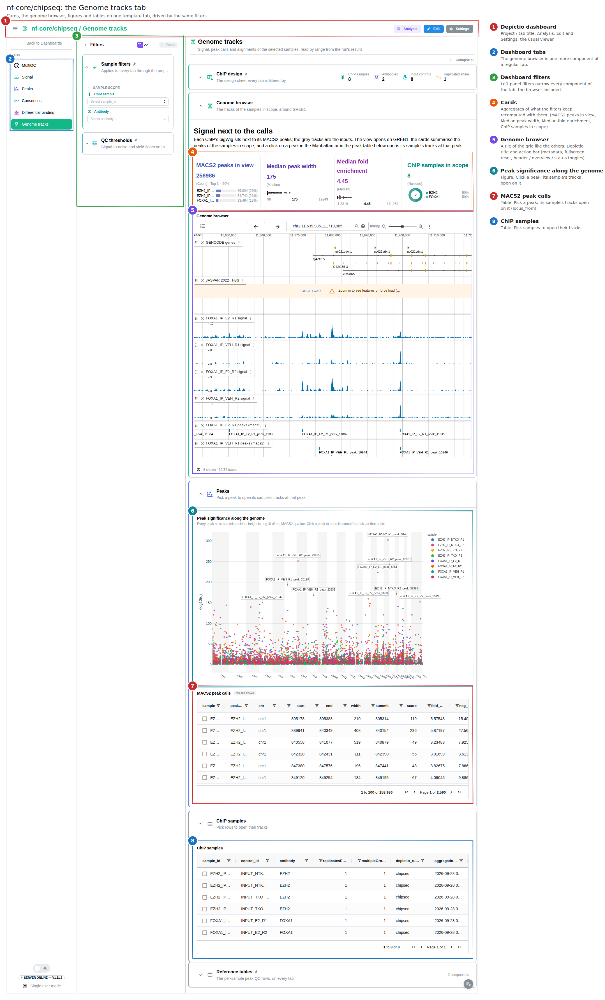
   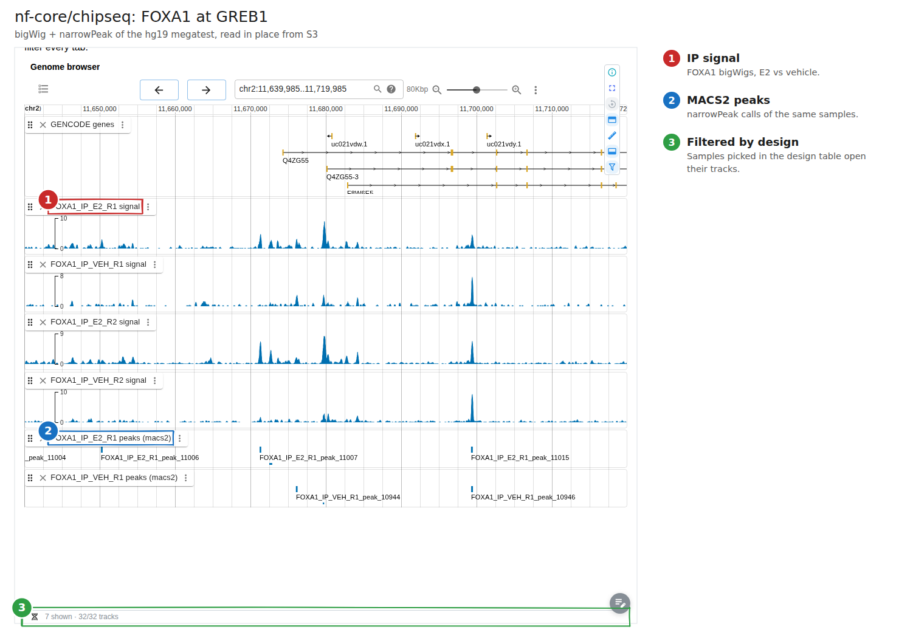
5. **nf-core/rnaseq 3.26.0**: strand-specific bigWig coverage and BAM per
   sample (hg19 megatest), with cards and two lassoable sample scatters.
   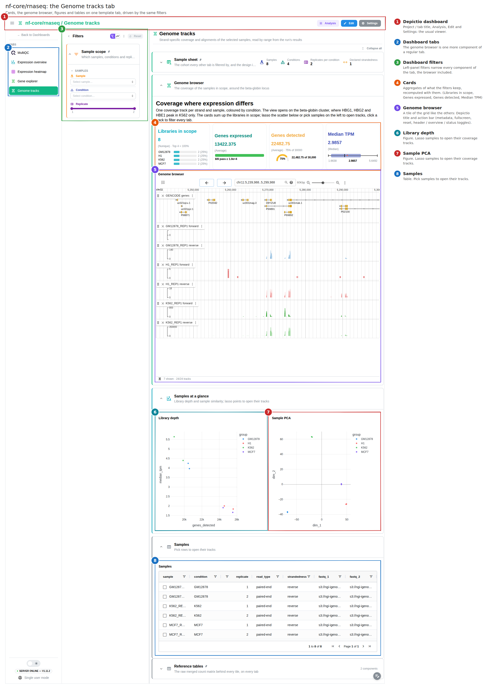
   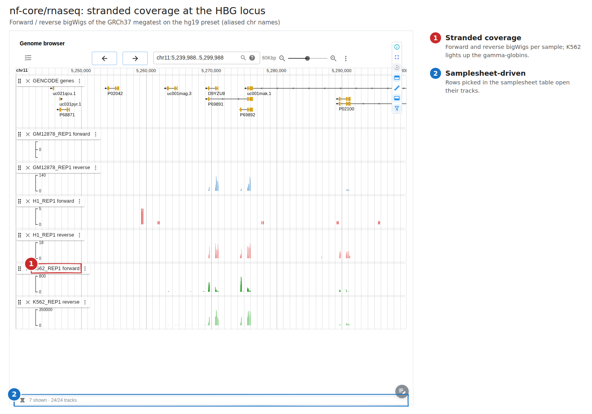

The nf-core templates read the tracks in place when `TRACKS_URI` is set
(`depictio run --var TRACKS_URI=s3://…/results/`; the template turns it into
`remote_base_uri`), and upload the files found in the results folder otherwise.

## Workflows

Each workflow has its own page under `jbrowse/`: a map of its tabs (the question each answers,
its tiles, what drives the browser), the tracks and their paths, use cases written as click
sequences, and limits. The generic gestures are in the dashboard Guide's "Browse the genome"
part, which shows only when a dashboard holds a browser; the pages do not repeat them. In a
dashboard, the section that holds a browser says in its description why it is there.

"Live" means the megatest results on the public bucket hold the tracks, so an ingest with
`--var TRACKS_URI=<megatest prefix>` reads them in place. "Recipe" means the recipe is tested on
a fake run tree only.

| Template | Tabs with a browser | Tracks | Use case | Status |
| --- | --- | --- | --- | --- |
| chipseq 1.2.0 | Genome tracks section | bigWig (ChIP and input), MACS2 peaks, BAM | A peak's signal against its input | Live |
| cutandrun 3.1 | Genome tracks section | bigWig, SEACR/MACS2 peaks, BAM | A target's peaks across replicates | Live |
| rnaseq 3.26.0 | Genome tracks section | Stranded bigWig, BAM | A gene's coverage per condition | Live |
| viralrecon 3.0.0 | Variants (navigator and browser); Coverage, Gene, Sample open it | VCF (snpEff), BAM | A mutation's reads and the amplicon under it | Live |
| [sarek 3.10.0](jbrowse/sarek.md) | Locus, Caller concordance | VCF per caller, Manta, CRAM | A call checked against the reads, callers compared on one locus | Live |
| [oncoanalyser 3.0.0](jbrowse/oncoanalyser.md) | Small variants, Copy number, Structural variants | PURPLE somatic, germline and SV VCFs, tumour and normal BAMs | A driver in tumour versus normal, a segment beside its breakends | Live |
| [variantbenchmarking 1.4.0](jbrowse/variantbenchmarking.md) | Germline, Structural & CNV | FP, FN and TP VCFs (rtg-tools, Truvari) | Where a callset's errors fall | Live (germline), recipe (Truvari) |
| [atacseq 1.2.2](jbrowse/atacseq.md) | Peaks, Locus | bigWig, broad peaks, BAM | One accessible region across libraries | Live |
| [nanoseq 3.0.0](jbrowse/nanoseq.md) | Isoform usage | bigWig, long-read BAM | The reads behind an isoform switch | Live (needs the annotation GTF) |
| [riboseq 2.0.0](jbrowse/riboseq.md) | ORF discovery | Coverage bigWig, P-site bedGraph, BAM | The footprints over an ORF | Live |
| [rnasplice 1.0.4](jbrowse/rnasplice.md) | Splicing Events | Stranded bigWig, BAM | A differential splicing event | Recipe |
| [rnafusion 4.1.3](jbrowse/rnafusion.md) | Breakpoints | STAR BAM | The reads at a fusion's 5' breakpoint | Live |
| [methylseq 2.3.0](jbrowse/methylseq.md) | none | Bismark bedGraphs are not indexed, BAMs unsorted | | Not added |

Next:

- rnavar, nascent and viralmetagenome, once their templates (#1265) are merged.
- atacseq 2.1.2, on the 2.x layout, once a megatest run holds its files.
- raredisease, a new template built from a `-profile test` run (its megatest prefixes hold
  `pipeline_info/` only).
- hic (`.hic` needs a HiC display, not linear tracks); eager, scrnaseq, mag have no tracks worth
  a browser.

## Reuse from BelSVedere

`weber8thomas/BelSVedere` (a JBrowse 2 SV browser) provided: the adapter
builder per format, the assembly block (2bit + `RefNameAliasAdapter` +
aliases), the UCSC 2bit/chrom.sizes URLs (its own T2T sizes were wrong, UCSC's
are used), the JEXL `itemRgb` colour callback for SV BEDs, the diff-based
sample → track sync with a cap, and the Range
lessons (clamp the end, strip conditional headers, expose `Content-Range`).

## Known limits and follow-ups

- JBrowse web workers are off (`makeWorkerInstance` is broken in 4.3.0): RPC
  runs on the main thread, fine for tens of tracks.
- The JBrowse chunk is ~1.4 MB (lazy; only loaded by a dashboard with a browser).
- One Range per request; BAM/CRAM streaming loads the API process (capped).
- Unindexed large BED/bedGraph files are refused; bgzip + tabix them.
- atacseq, sarek and nanoseq tabs are not written yet; `remote_read` can be
  merged with the manifest-scan reader of #1120 / #965 later.
