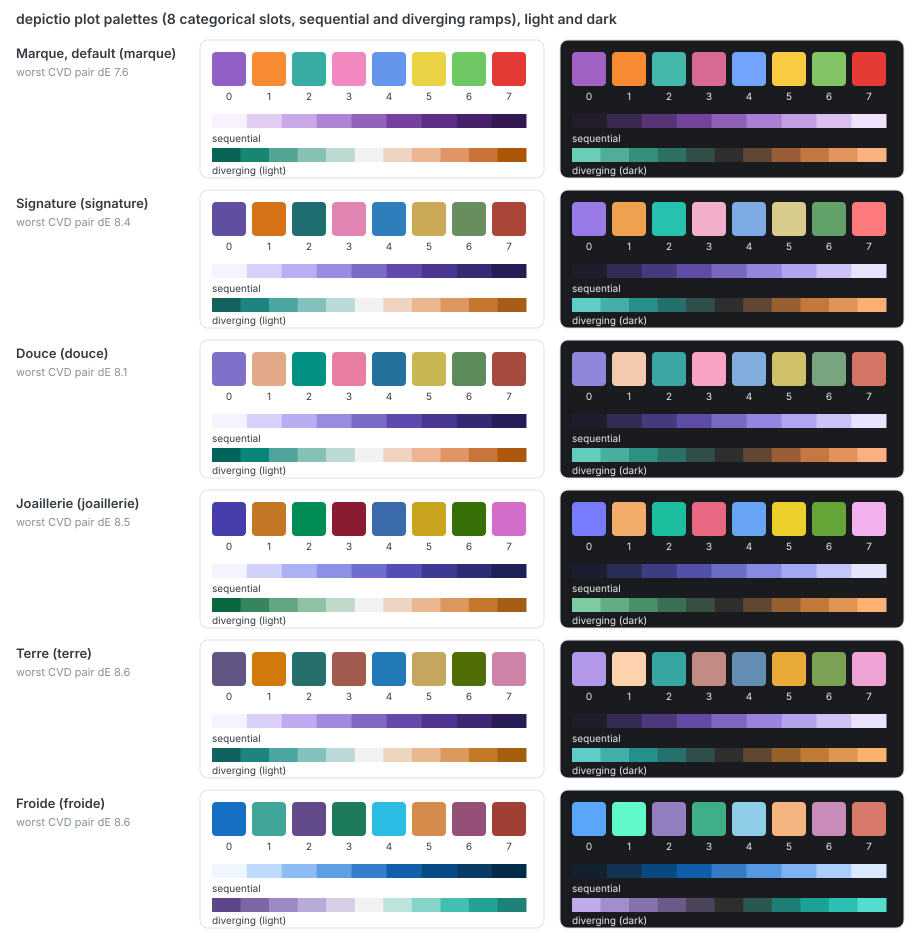
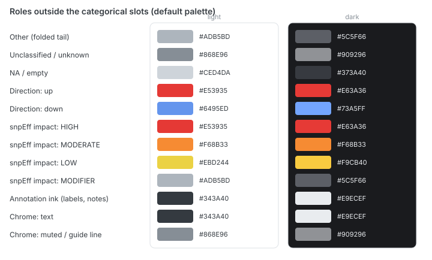
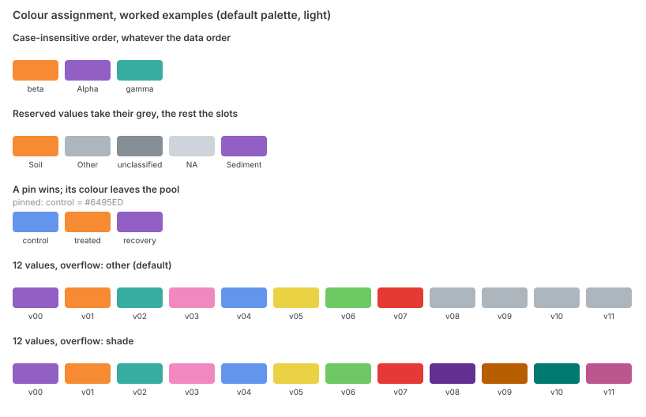

# Plot palettes and figure colour roles

How depictio picks the colour of every mark on a figure, card or advanced viz:
which palettes exist and why they were chosen, the measurements that hold them
to it, how the brand's primary and secondary colours relate to the plot
palette, and which colours belong to the data and which to the annotations
around it.

Swatch sheets in this page are generated from the palette source by
`scripts/gen_palette_swatches.py`, so they show exactly what a figure draws.

## One source, two sides

| File | Role |
| --- | --- |
| `depictio/models/palettes/depictio_palettes.json` | The only place a colour is written down: palettes, reserved greys, direction colours, ordinal scales, annotation ink, chrome, style constants, test thresholds |
| `depictio/models/palettes/__init__.py` | Python reader: `categorical`, `sequential`, `diverging`, `assign_colors`, `semantic`, `direction`, `ordinal_colors`, `annotation_ink`, `chrome`, `style` |
| `packages/depictio-react-core/src/palettes.generated.ts` | TypeScript copy, written by `scripts/gen_palette_ts.py`, never edited by hand |
| `depictio/models/palettes/assign_cases.json` | Parity cases: the same inputs must give the same colours in Python and TypeScript |
| `depictio/models/palettes/ui_hues.py` | Mantine hue names (`teal`, `grape`...) re-drawn in the active palette inside a dashboard |
| `depictio/models/palette_tracks.py` | Track colours beside a colour scale (heatmap annotation tracks, UpSet) |
| `depictio/tests/unit/test_palettes.py` | The measurements below, plus TS freshness and assignment parity |

Nothing else in the code base carries a categorical palette of its own. The
server figure builder, the React advanced-viz renderers, the catalog preview and
the notebook export all read these values.

## The six palettes



| Id | Label | Intent |
| --- | --- | --- |
| `marque` | Marque (default) | The depictio brand colours (violet, orange, teal, pink, blue, gold, green, red), nudged only as far as needed to stay distinct under every colour-vision deficiency |
| `signature` | Signature | Denser, drawn identity: violet, orange, deep teal, pink, blue, gold, sage, brick |
| `douce` | Douce | Lighter, calmer editorial tones |
| `joaillerie` | Joaillerie | Deep, saturated jewel tones |
| `terre` | Terre | Warm natural tones, brand violet and teal as accents |
| `froide` | Froide | Blues, teals and violets first; warm hues as late accents |

Each palette has:

- **8 categorical slots**, in a light and a dark variant that keep the same hue
  per slot (slot 2 is teal in both modes), so switching the colour scheme never
  re-colours a category;
- a **sequential ramp** of 9 stops, monotone in lightness, light to dark in
  light mode and from the background end in dark mode;
- a **diverging ramp** of 11 stops with a neutral middle (`#F2F2F2` light,
  `#2E2E2E` dark).

Why 8 slots: past about 8 hues no palette keeps every pair distinct for
readers with a colour-vision deficiency. A figure with more categories folds
its tail (see [Overflow](#overflow-more-values-than-slots)) instead of
recycling hues.

## How the palettes were selected: the metrics

Every palette passes the same three tests, in both modes
(`test_palettes.py`, thresholds in the JSON `thresholds` block):

1. **Distinct under every vision.** Each slot is simulated as seen with normal
   vision, deuteranopia, protanopia and tritanopia (Machado, Oliveira and
   Fernandes 2009, severity 1.0), then every pair of slots is compared with
   CIEDE2000 (ΔE00). The smallest pair over the four visions must be
   **at least 7.5**. Around 2 is a just-noticeable difference; 7.5 keeps two
   adjacent bars or two legend chips apart at a glance.
2. **Readable on the card.** Contrast ratio (WCAG relative luminance) of each
   slot against the card surface (`#FFFFFF` light, `#1A1B1E` dark) is at least
   **1.5 in light mode and 3.0 in dark mode**.
3. **Ramps that read in order.** Sequential stops are strictly monotone in
   lightness; a diverging ramp has its neutral exactly in the middle.

Measured values (`depictio.models.palettes.cvd`; worst = the smallest pair over
all four visions):

| Palette | Mode | Normal | Deutan | Protan | Tritan | Worst ΔE00 | Lowest contrast |
| --- | --- | ---: | ---: | ---: | ---: | ---: | ---: |
| marque | light | 22.7 | 7.6 | 8.3 | 7.7 | **7.6** | 1.52 |
| marque | dark | 19.2 | 7.9 | 8.8 | 7.6 | **7.6** | 4.12 |
| signature | light | 21.0 | 9.5 | 11.7 | 10.4 | **9.5** | 2.24 |
| signature | dark | 16.6 | 8.4 | 8.4 | 8.6 | **8.4** | 5.15 |
| douce | light | 15.0 | 8.2 | 8.6 | 8.1 | **8.1** | 2.03 |
| douce | dark | 14.9 | 8.6 | 8.7 | 8.2 | **8.2** | 5.30 |
| joaillerie | light | 15.3 | 8.9 | 9.2 | 10.9 | **8.9** | 2.38 |
| joaillerie | dark | 14.9 | 8.6 | 9.1 | 8.5 | **8.5** | 4.97 |
| terre | light | 17.3 | 9.7 | 12.3 | 9.7 | **9.7** | 2.34 |
| terre | dark | 15.7 | 9.4 | 9.3 | 8.6 | **8.6** | 4.93 |
| froide | light | 15.7 | 9.7 | 9.2 | 9.3 | **9.2** | 2.23 |
| froide | dark | 14.5 | 9.5 | 8.8 | 8.6 | **8.6** | 4.94 |

For comparison, the same measurement on common library defaults and on the reference colour-blind safe set:

| Palette (first 8 colours) | Normal | Deutan | Protan | Tritan | Worst ΔE00 | Lowest contrast |
| --- | ---: | ---: | ---: | ---: | ---: | ---: |
| Plotly express default | 12.6 | 2.6 | 0.7 | 6.5 | **0.7** | 1.41 |
| matplotlib tab10 | 16.2 | 4.6 | 1.3 | 9.5 | **1.3** | 2.53 |
| Okabe-Ito (reference CVD-safe set) | 21.7 | 11.6 | 12.2 | 10.9 | **10.9** | 1.32 |

Under protanopia two of the Plotly default slots are indistinguishable
(ΔE00 0.7); every depictio palette stays at 7.5 or above, in the range of
Okabe-Ito, while keeping the brand hues.

**The light contrast floor is a deliberate trade-off.** WCAG 2.2 asks 3:1 for
non-text graphics. Holding every slot to 3:1 on white removes the yellow and
light green an 8-hue CVD-safe set needs, and the CVD separation drops. The
default palette's lowest slot is its gold (`#EBD244`, 1.52 on white). What
keeps it legible: filled marks are large areas, small scatters get an outline
(`style.scatter_markers`), and **no text ever takes a slot colour as-is**: UI
hues are deepened to text contrast (`ui_hues.py`), and labels use the
annotation ink. In dark mode every slot clears 3:1.

The marque palette is the brand made safe: the brand hues, nudged only as far
as needed for the worst pair to reach the threshold. It is the
default because a dashboard should look like depictio before anyone picks a
palette.

## Colour roles: data, annotation, chrome

A figure carries colours of different kinds. Keeping them apart is what lets a
reader trust that a colour means a category.



| Role | Where it comes from | What it draws | Rule |
| --- | --- | --- | --- |
| **Data, categorical** | the palette's 8 slots | one category per hue: bars, points, lines, legend chips, filter chip dots | [assignment rule](#assignment-rule) below |
| **Data, continuous** | sequential ramp | heatmaps, colour scales, densities | low values near the background, emphasis at the far end |
| **Data, signed** | diverging ramp | fold changes, z-scores, correlations | neutral middle at zero; in marque, teal (slot 2) at the low end and orange (slot 1) at the high end |
| **Remainder values** | `semantic` greys | Other, Unclassified, NA | never a hue: a grey says "not a category of interest" |
| **Direction** | `direction` | up and down in volcano, MA, DA bars, CNV, dot-plot fold change | red up, blue down, the same in browser and export; a direction never borrows a category's colour |
| **Ordinal verdict** | `ordinal_vocabularies` | a column whose values all belong to one documented scale (snpEff impact) | most severe first: HIGH red, MODERATE orange, LOW gold, MODIFIER grey; [source](https://pcingola.github.io/SnpEff/snpeff/inputoutput/) |
| **Reference tint** | `style.reference_tint` | bars and points at or below a reference line | a lighter twin of the figure's hue (light `#925FC4` above, `#C2A1E8` at or below) |
| **Annotation** | `annotation_ink`, `chrome.muted` | reference guide labels, bar labels, group n, cell values, "N more not shown" notes | ink, never a data hue; ΔE00 at least 7.5 from every slot of every palette (tested) |
| **Chrome** | `chrome` | axes text, grid, zero line, hover label, surfaces | near-transparent grid, soft zero line, one font (Inter) |
| **Tracks beside a scale** | `palette_tracks.track_palette` | heatmap annotation tracks, UpSet side tracks | skip the slots the scale already uses (diverging: 1, 2; sequential: 0; UpSet sets: 0 to 2) |

Two consequences worth knowing:

- **Annotations never look like data.** A reference line is drawn in the muted
  chrome grey, 2 px dashed, with its label in the text ink at 12 px
  (`style.reference_guide`). A cell value on a heatmap takes the text ink or
  white, whichever contrasts more with the cell beneath it.
- **Colour only names a category.** When colour would only repeat the axis
  (px `color=x`, one trace per bar), the overview look spends it on the
  reference instead: above the line in the hue, at or below in its tint, under
  a two-entry legend ("Above the median ...", "At or below the median ...").
  With no reference, repeated bars take one hue and lose their legend.

## Brand primary and secondary vs the plot palette

There are two colour systems, and they meet in a defined way.

| | Brand palette | Plot palette |
| --- | --- | --- |
| Fields | `primary`, `secondary`, `tertiary` (+ `success`, `warning`, `danger`) | `plots.palette`, `plots.colorway`, `plots.sequential`, `plots.overflow` |
| Colours | the app chrome: buttons, tabs, active pills, header accents | the data: figure traces, card bands, filter chip dots |
| Set in | env (`DEPICTIO_BRANDING_*`), `/admin` Branding, dashboard Settings, `brand_theme:` in YAML | the same three layers |
| Reach | `tint_mode: accent` re-tints the primary only; `full` also maps secondary and tertiary onto the app's `teal` and `orange` accents | every figure, card and advanced viz in scope |

### Which categorical colours a figure gets

From strongest to weakest; the first that applies wins:

1. **A pin** in the dashboard's `category_colors` (column, then value).
2. **An explicit list** in `plots.colorway` (the form's "Custom").
3. **A named palette** in `plots.palette` (the form's "Preset"), which also
   fills the sequential ramp and both dark variants.
4. **Derived from the brand hues** (the form's "From palette"): when the brand
   sets hex `primary`, `secondary`, `tertiary`, `derive_colorway` cycles those
   hues first and only then steps lightness, so the first series are
   recognisably the brand and adjacent series always differ in hue. With a
   single hue it falls back to golden-angle rotation.
5. **The default palette** (`marque`) when none of the above is set.

Layers merge field by field (instance env, then `/admin`, then the
dashboard). A layer naming `plots.palette` resets the colour lists of the
layers below it, so an instance custom colorway does not beat a dashboard's
preset choice.

### Section, tab and KPI colours follow the plot palette

Dashboards name chrome colours as Mantine hues: `tab_icon_color: teal`, a
section in `grape`, a KPI icon in `orange`. Inside a dashboard those names are
re-drawn in the **active plot palette** (`plots.palette`, else the default),
so the chrome and the figures read as one family:

| Mantine name | Slot (marque order) | Note |
| --- | --- | --- |
| `violet`, `grape` | 0 violet | `grape` shifted 25° in hue to stay apart |
| `orange` | 1 orange | |
| `teal`, `cyan` | 2 teal | `cyan` shifted 25° in hue, a little more chroma |
| `pink` | 3 pink | |
| `blue`, `indigo` | 4 blue | `indigo` darker and shifted 15° |
| `yellow` | 5 gold | |
| `green`, `lime` | 6 green | `lime` lighter and shifted -15° |
| `red` | 7 red | |

Each name becomes a 10-shade Mantine tuple anchored on the slot colour (shade 6
in light mode, the shade a filled control paints; shade 4 in dark mode, the
shade text and icons take), deepened where needed to reach text contrast.
`gray`, `dark`, `black`, `white` and `brandPrimary` are never remapped:
buttons keep the brand primary, and `brandPrimary` is offered as a section
colour so a section can wear the brand instead of a palette hue. The `froide`
palette lists its own mapping, since its slots run in another hue order.

## Assignment rule

The same function on both sides (`assign_colors` in Python, `assignColors` in
TypeScript), checked against `assign_cases.json`:

1. a **pinned** colour wins;
2. a **reserved** value takes its semantic grey (`other`, `others`, `other taxa`, `rest` →
   Other grey; `unclassified`, `unknown`, `unassigned`, `undetermined` →
   Unclassified grey; empty, `na`, `n/a`, `nan`, `none`, `null` → NA grey; case
   insensitive);
3. the remaining values, in **case-insensitive order over the whole universe**
   of values (never the filtered subset), take the slots no pin already uses.
   `ranked` keeps the caller's order instead (largest first, for `top_n`);
4. past the last slot, a value **never repeats a hue** (see overflow).

Because order comes from the whole universe, a category keeps its colour when
a filter removes its neighbours, and across every figure of the dashboard.



Two further rules apply where several columns share a figure or a dashboard:

- **Columns drawn together never share a colour.** Auto colours resolve in
  the order the columns are declared in `category_colors`. Each column avoids
  the colours of the columns a component draws beside it (their pins, and what
  earlier auto columns took): a sunburst ring skips the hues of the rings
  inside it, an UpSet strip skips the sets' colours. Columns that never meet in
  one component keep the whole palette. Past the palette, a column takes darker
  twins, those of other columns' hues first, before reusing an avoided colour.
- **Auto colours avoid other columns' pins.** In `category_colors: {phylum:
  auto}`, palette slots another column pins go last, so the top phylum does not
  wear a colour that already means something else on the dashboard. A ranked
  column (`auto:<column>`) colours only its largest values and binds only the
  colours it draws.

### Overflow: more values than slots

| Setting | Values past slot 8 | When to use |
| --- | --- | --- |
| `overflow: other` (default) | the Other grey, one legend entry | a long tail nobody reads value by value (taxa, gene sets) |
| `overflow: shade` | first a lightness-shifted twin of each slot (OKLab L -0.16 light, +0.14 dark), then grey | up to 16 values that each matter; named palettes only, a free colorway falls back to grey |

Independently, the overview look folds the smallest traces past `top_n = 8`
into a grey "Other" legend entry and notes "N more not shown" above the plot.
Colour only: no trace and no point is dropped, and each trace keeps its name in
the hover. `auto:<column>` ranks values by the sum of that column before colouring,
so the largest get the hues.

## Figure marks and annotations

The overview look (`figure_style: default`) applies a few rules to every UI
figure after the theme; `classic` leaves the drawing as built, `minimal` adds
the landing-page look on top. Every rule yields to a value the author set.

| Rule | Constant |
| --- | --- |
| Colour against the reference, else one hue | `style.reference_tint` |
| Categorical bars sorted biggest first | |
| Other / Unclassified / NA last and grey; tail past 8 folded | `style.top_n = 8` |
| Bars rounded | `style.bar_corner_radius = 4` |
| Markers by point count: 9 px outlined up to 50 points, 7 px to 500, 5 px faint to 5000, 3.5 px beyond | `style.scatter_markers` |
| Lines 2.5 px (1.5 px past 8 series); a dot on each point up to 60 points, so a line between two samples is not read as a trend | `style.line_style` |
| Long category ticks cut at 28 characters with an ellipsis, full name in the hover | `TICK_LABEL_MAX` |

Automatic marks (`annotations` on a UI figure):

| Mark | Automatic when | Declared |
| --- | --- | --- |
| `bar_labels` | up to 12 unstacked bars | `value` or `percent` |
| `group_n` | box and violin plots | `true` |
| `cell_values` | heatmaps up to 400 cells | `true` |
| `hidden_note` | categories were folded or points sampled | `true` |

Without an `annotations` block each mark is automatic by figure type. With a
block, only the marks it turns on are drawn, so `annotations: {}` draws none.

## Examples

Pin a few colours, colour the rest automatically, ranked by abundance:

```yaml
category_colors:
  condition:
    control: "#868E96"      # pinned: control in neutral grey
    "*": auto               # every other value from the palette
  phylum: "auto:rel_abundance"   # largest phyla first get the hues
```

Pick a named palette for one dashboard, with shades past 8 values:

```yaml
brand_theme:
  plots:
    palette: signature
    overflow: shade
```

The same at instance level, from the environment:

```bash
DEPICTIO_BRANDING_THEME='{"plots": {"palette": "signature"}}'
```

Brand-derived figure colours (no palette named): the colorway walks
`primary`, `secondary`, `tertiary` first:

```yaml
brand_theme:
  primary: "#1B4F72"
  secondary: "#D35400"
  tertiary: "#117A65"
```

A reference line from the data, and one from a tool's documented default:

```yaml
reference_lines:
  - axis: y
    stat: median
    column: completeness      # label reads "median completeness"
  - axis: y
    value: 90
    label: "high-quality draft"
    source: "MIMAG, Bowers et al. 2017"
```

A fixed value needs its `source` in a catalog render (RULES.md §17): a line
without one is either data-defined (`stat`) or refused.

Bar values as percentages, no other marks:

```yaml
annotations:
  bar_labels: percent
```

The drawing exactly as built, without the overview look:

```yaml
figure_style: classic
```

## Changing a palette

1. Edit `depictio/models/palettes/depictio_palettes.json`.
2. `python scripts/gen_palette_ts.py` (writes `palettes.generated.ts`).
3. `DEPICTIO_CONTEXT=cli python scripts/gen_palette_swatches.py` (the sheets
   in this page).
4. `pytest depictio/tests/unit/test_palettes.py`: a palette that fails the CVD
   or contrast threshold, a stale TS copy or a broken parity case fails here.
   If a parity case's expected colours change on purpose, regenerate them in
   the same commit.

A new palette needs its 8 slots in both modes, both ramps, and, if its slots
are not in the marque hue order, a `ui_hues.per_palette` entry.
