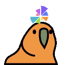

# depictio Slack emojis

Custom Slack emojis made from the depictio rose, in the spirit of the nf-core /
Nextflow Slack (`:nextflow-party:`, `:nf-core-spin:`, ...).


## The rose's own animations

The same motion as `<DepictioRose>` in the viewer
(`depictio/viewer/src/components/rose/depictio-rose.js`), captured frame by frame.

| Emoji | Name | Rose mode |
| --- | --- | --- |
|  | `:depictio:` | `logo`, the still mark |
|  | `:depictio-loading:` | `loading`: the data loop that never rests (also `petals`) |
|  | `:depictio-fan:` | `fan`: opens like a hand fan, springs into the logo, folds back |
|  | `:depictio-pulse:` | `pulse`: opens, then a pulse runs clockwise round the logo |
|  | `:depictio-data:` | `live`: the radii change like a chart refreshing |
|  | `:depictio-sweep:` | `sweep`: an endless clockwise wave |
|  | `:depictio-wave:` | `wave`: opening, one sweep, then the data loop |
|  | `:depictio-spring:` | `spring`: opens clockwise with a spring, closes at once |
|  | `:depictio-domino:` | `domino`: snappier, closes clockwise too |

`fan`, `data` and `wave` play faster than in the app so they fit Slack's 128 KB at 20 fps.

## Classic Slack effects

| Emoji | Name | |
| --- | --- | --- |
|  | `:depictio-spin:` | turns around its centre |
|  | `:depictio-fast-spin:` | the same, at full speed |
|  | `:depictio-party:` | the wedge colours rotate while the rose bobs |
|  | `:depictio-bounce:` | bounces, squashing on landing |
|  | `:depictio-intensifies:` | shakes |
|  | `:depictio-parrot:` | the party parrot in the rose's colours, a spinning rose for a hat |

All are 128x128 with a transparent background and under Slack's 128 KB limit.

## Adding them to Slack

Workspace menu -> **Tools & settings** -> **Customize workspace** -> **Emoji** ->
**Add custom emoji**, then upload each file under its file name.

## Regenerating

The emojis are generated, never edited by hand. It needs Node and the Playwright
Chromium of the e2e suite (`npm ci` in `depictio/tests/e2e-playwright`):

```bash
uvx --with pillow --with numpy python scripts/generate_slack_emojis.py
```

`:depictio-parrot:` remixes the standard party parrot from the
[Cult of the Party Parrot](https://cultofthepartyparrot.com/), which the script downloads
at generation time (`--parrot PATH` to use a local copy); the sprite itself is not kept
in this repo.

See the script's docstring for the other options (`--size`, `--output`).
