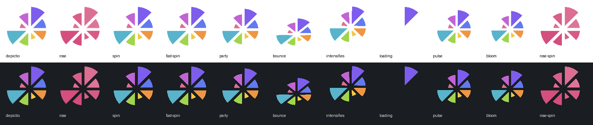
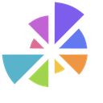
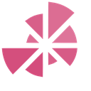
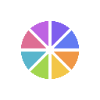

# depictio Slack emojis

Custom Slack emojis made from the depictio favicon, in the spirit of the nf-core /
Nextflow Slack (`:nextflow-party:`, `:nf-core-spin:`, ...).



| Emoji | Name | |
| --- | --- | --- |
|  | `:depictio:` | the logo |
|  | `:depictio-rose:` | every petal in the logo's pink |
|  | `:depictio-spin:` | turns around its hub |
|  | `:depictio-fast-spin:` | the same, at full speed |
|  | `:depictio-party:` | party-parrot style rainbow wobble |
|  | `:depictio-bounce:` | bounces, squashing on landing |
|  | `:depictio-intensifies:` | shakes |
|  | `:depictio-loading:` | petals light up one by one, clockwise |
|  | `:depictio-pulse:` | heartbeat |
|  | `:depictio-bloom:` | petals drift out from the hub and back |
|  | `:depictio-rose-spin:` | the pink rosette, spinning |

All are 128x128 with a transparent background and under Slack's 128 KB limit.

## Adding them to Slack

Workspace menu -> **Tools & settings** -> **Customize workspace** -> **Emoji** ->
**Add custom emoji**, then upload each file under its file name.

## Regenerating

The emojis are generated from `docs/images/favicon.png`, never edited by hand:

```bash
uvx --with pillow --with numpy python scripts/generate_slack_emojis.py
```

See the script's docstring for options (`--size`, `--source`, `--output`).
