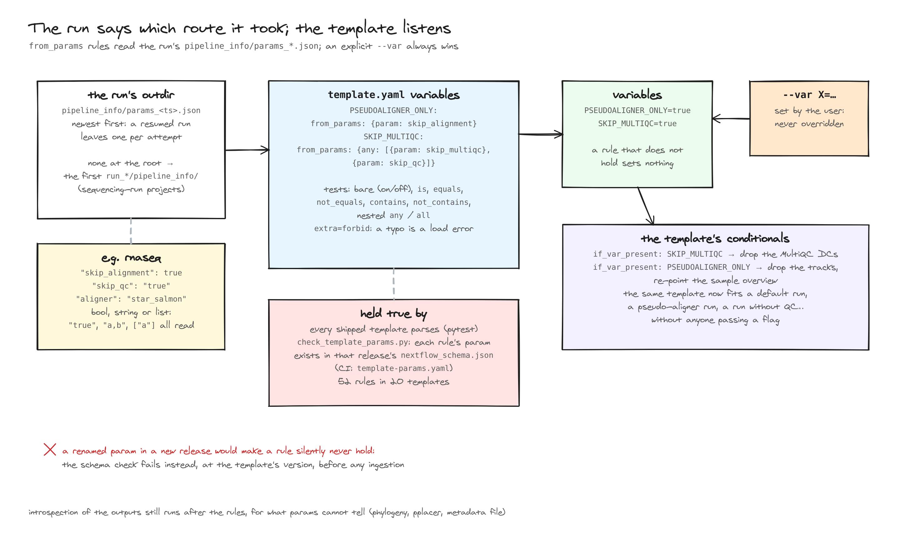

# Template variables from the run's own parameters

A template has route variables (`SKIP_MULTIQC`, `PSEUDOALIGNER_ONLY`,
`NANOPORE`…) that its conditionals read to drop or re-point data collections.
Until now, a run made with `--skip_qc` needed `--var SKIP_MULTIQC=true` from
whoever ingested it. A `from_params` rule lets the template read the answer from
the run itself.



The schema is generated by `dev/diagrams/template_params.py`.

## Writing a rule

```yaml
variables:
  - name: PSEUDOALIGNER_ONLY
    description: "--skip_alignment: no STAR, no tracks"
    from_params: {param: skip_alignment}
  - name: SKIP_MULTIQC
    description: "no MultiQC report"
    from_params: {any: [{param: skip_multiqc}, {param: skip_qc}]}
  - name: NANOPORE
    from_params: {param: platform, equals: nanopore}
  - name: SKIP_ARRIBA
    from_params: {all: [{param: tools, not_contains: arriba}, {param: tools, not_contains: all}]}
```

| Test | Holds when |
|---|---|
| bare `param` | the param is on: `true`, `"true"`, a non-empty string, a non-zero number, a non-empty list |
| `is: false` | the param is off or absent |
| `equals` / `not_equals` | the value, any case (`not_equals` also holds when absent) |
| `contains` / `not_contains` | an item of a list param, or of a comma-separated string |
| `any` / `all` | one / every nested rule holds |

A rule that holds sets its variable to `"true"`. A rule that does not hold sets
nothing. An explicit `--var` is never overridden.

## Where the params come from

The newest `pipeline_info/params_*.json` under the data root (a resumed run
leaves one per attempt; only the last describes the outputs). When the root
holds runs (`run_*/`), the first run's file is read, with a warning: pass the
variable with `--var` if the runs differ. No file: no variable is set, and the
template behaves as before.

## Checks

- Every shipped template is loaded in the tests: an unknown key under a variable
  (`from_param:`) or a malformed rule is a load error, not a rule that never
  holds.
- `scripts/check_template_params.py` fetches each template's release of
  `nextflow_schema.json` and fails when a rule reads a param that release does
  not have (run by `.github/workflows/template-params.yaml` when a template
  changes).
